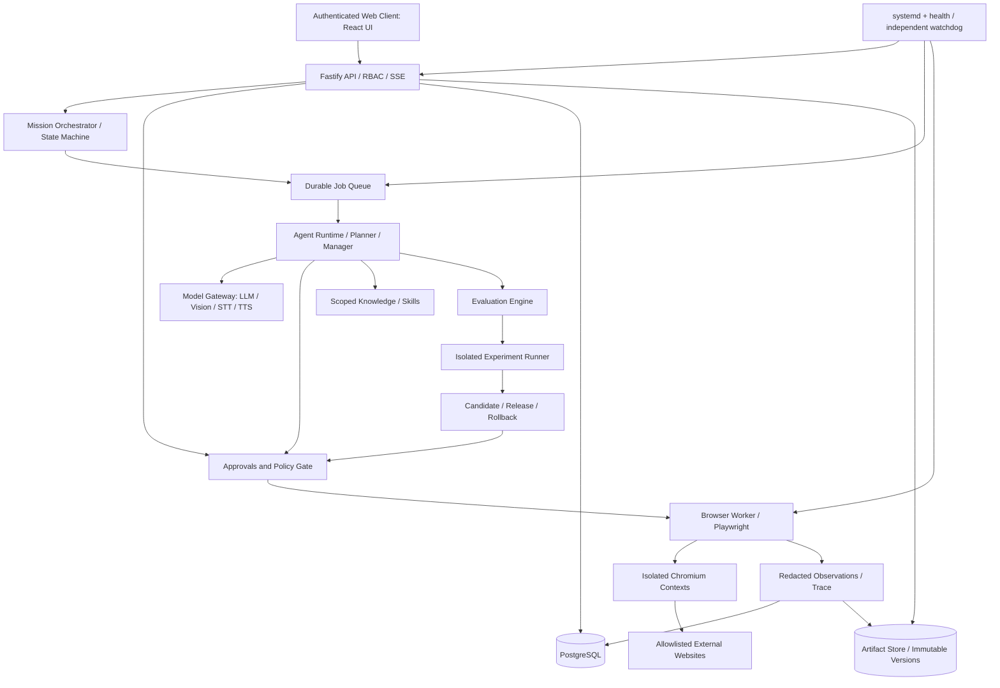

# AGENT COMPANY OS
## Complete UI/UX, Product Architecture, Interaction Contract, and Sequential Claude Code Implementation Specification

**Document:** ACO-MASTER-001  
**Version:** 1.0 — Proposed design baseline  
**Date:** 2026-11-20  
**Status:** DESIGN ONLY. No code changes or deployment authorized.  
**Audience:** Owner, Claude Code, UI designers, frontend/backend engineers, QA, security reviewers.  
**Working product name:** *Agent Company OS* (rename freely; no product name is presumed approved).  
**Primary deployment:** Linux SSH VPS, web dashboard, Playwright-managed Chromium browser sessions.  
**Workflow rule:** Complete one implementation stage, produce evidence and an approval request, then **STOP**. Never begin the next stage without the Owner's explicit approval.

> **North star:** An accountable, self-improving digital company. A human gives an outcome-driven mission; a managed hierarchy of specialized agents plans, executes permitted website workflows, records its reasoning and communications, produces usable versioned results, independently verifies its work, and proposes improvements to skills, agents, and company structure. Nothing is promoted merely because an AI says it improved.

---

# 0. Authority, source fidelity, and project boundaries

## 0.1 Status of references

1. **User-supplied project direction:** the present brief is the definitive product requirement. It supersedes domain-specific assumptions from AXoR.
2. **AXoR-related reference repositories:** `https://github.com/MexcSell/axor` and `https://github.com/thomaschang0912/subnet-scout`. Readable README content confirms an extensive dashboard/product surface; **do not infer** that any desired new service or autonomous function is currently operational.
3. **Agent Company reference:** `https://github.com/MexcSell/Agent_Company.git`. Repository metadata was discoverable; the README paths attempted during specification preparation were not available. Code, component choices, and behavior have **not** been verified. Inspect read-only in Stage 0.
4. **VPS-only references:** `/home/thomas/subnet-scout/`, `docs/update_2026-11-15`, `docs/update-19`. These paths were **not accessible from the document-preparation environment**. Stage 0 must inspect their contents on the actual VPS before claiming any code reuse or compatibility.
5. **Prior AXoR UI specifications considered:** `AXoR_UI_v3_Detailed_Pages_and_Agent_Function_Specification.docx`, `AXoR_UI_and_Agent_Function_Specification_v3.docx`, `AXoR_Homepage_and_Platform_Update_Specification.docx`, and `BrowserAgent_Engineering_Spec_Claude_Prompts.md` from the user's prior project materials. They inform the page/tab completeness, mission-isolated agent identity, evaluation, approvals, branching, and browser security requirements here.
6. **Public technical documentation:** https://playwright.dev/docs/browser-contexts (browser isolation), https://motion.dev/docs/react-accessibility (reduced-motion behavior), https://motion.dev/docs/react-layout-animations (layout transitions). Verify current API versions/compatibility during Stage 0.

## 0.2 Explicit inclusions

- Mission-centric UI: list and progress, delegation hierarchy, task graph, agent-to-agent conversations, user commands and replies, image/document input, live browser visibility, approvals, reports, and outcome artifacts.
- Agents, teams, departments, organizational structure, models (LLM, vision, STT, TTS, translation and embeddings), users, roles, governance, settings, themes and styling.
- Versioned results: websites, files, documents, images, research reports, datasets, code, videos when produced by authorized workflows, screenshots, and packaged downloads.
- Agent performance cards, evidence-based coaching, reusable knowledge, isolated experiments, controlled source modifications, company-structure proposals, preview and rollback.
- Authorized browser workflows using Playwright-owned Chromium on the VPS. Future optional Chrome extension adapter is separate and not a prerequisite.
- High-quality, animated, icon-first UI/UX with universal accessible help and complete empty/loading/error states.

## 0.3 Explicit exclusions

- **No Bittensor, miners, tokens, subnet scoring, wallet economics, or blockchain modules.**
- **No Docker/containers as a project feature or deployment dependency.** Run native services under systemd with dedicated OS permissions. Higher-isolation options may be evaluated later only by explicit Owner decision; do not quietly introduce Docker.
- No unapproved production migrations, updates, SSH service changes, security-control bypasses, unapproved third-party access, or destructive repository operations.
- No claim that Playwright can directly control an arbitrary visitor's existing Chrome tabs; that requires a separate, explicitly permissioned browser adapter.
- No autonomous promotions of security policies, permissions, secrets, deployment pipelines, or live source code without prescribed external gates.

## 0.4 Design decisions / unresolved items

| ID | Proposed default | How to resolve |
|---|---|---|
| D-01 | React + TypeScript + Vite; native Linux services | Validate VPS runtime and source reuse in Stage 0. |
| D-02 | Desktop-first, fully responsive; target 1440×900 | UI review after Stage 1. |
| D-03 | Managed Playwright Chromium on VPS | Browser adapter boundary is mandatory. |
| D-04 | Multi-user-ready schema; Owner, Admin, Operator, Reviewer, Viewer | Permissions tested before backend access. |
| D-05 | PostgreSQL for production; SQLite only for local single-user prototype if needed | Choose one migration path before Stage 2. |
| D-06 | SSE for mission updates; WebSocket only for justified two-way live control | Benchmark bandwidth/complexity before adding. |
| D-07 | Default autonomy: prepare/read/preview; external effects require approval | Site-specific grants override neither policy nor tenant boundaries. |
| D-08 | Self-evolution: propose → isolated experiment → independent evaluation → owner-reviewed promote | No automatic source deployment. |
| D-09 | Protect existing source trees and all production data | Owner must approve exact write path and change scope. |
| D-10 | Theme family: Flat, Luminous, Pretty, Fancy; Light/Dark/System | Appearance does not change logic or permissions. |

---

# 1. Product goal, personas and measurable outcomes

## 1.1 Product intent

The interface must feel like commanding a *living company*, not prompting a chatbot. The hierarchy is real and inspectable. An agent's work must be traceable to delegated tasks, tool actions, browser observations, artifacts, quality checks, and a final business result. The user can intervene at any point with text, image, files, or approvals. Learning and reorganizations must be visible, evaluated, reversible, and distinguishable from merely proposed change.

**Primary loop:** Mission → plan → delegate → act → observe → report upward → verify independently → publish result → extract learning → propose evolution → test → approve → promote/rollback.

## 1.2 Success measures (initial targets; acceptance baselines proposed)

| Measure | Definition | Initial requirement |
|---|---|---|
| Verified mission completion | Accepted outcomes / eligible attempted missions | Display actual numerator, denominator and period; don't invent a target until baseline measured. |
| Time to first visible execution event | From Start confirmation to first observed task event | p95 under 5 seconds for local fixture tasks (benchmark). |
| Reproducible execution | Replaying fixture from fixed input reaches same verified outcome | >=90% benign fixture completion before external beta. |
| Permission integrity | Unauthorized navigations, tool actions or final submissions | 0 in security suite. |
| Artifact traceability | Outputs with mission/run/version/hash/source lineage | 100% of downloadable results. |
| Evidence coverage | Completed tasks with linked outcome evidence | 100% for tasks marked VERIFIED. |
| Human oversight | Sensitive changes reach explicit approval gate | 100% gated by policy. |
| Improvement proof | Candidate beats baseline on comparable test set without regression | Mandatory before promotion; show sample size and confidence. |
| UI completeness | Every route/tab/modal tested in empty/loaded/error/permissions states | 100% before release. |
| Accessibility | Keyboard, focus, labels, contrast, reduced motion | WCAG 2.2 AA target. |

## 1.3 Personas and roles

| Role | Typical use | Boundaries |
|---|---|---|
| Owner | Defines strategy, approves risky actions, promotes versions, changes company structure | Only role for production releases and policy changes by default. |
| Admin | Users, tenants, model/provider configuration, service operations | Cannot silently bypass Owner-only gates. |
| Operator | Creates/manages permitted missions and browsers; intervenes in conversations | No admin privileges by implication. |
| Reviewer | Evaluates evidence, approves assigned review queues | Cannot approve own evaluated submission where separation of duties applies. |
| Viewer | Read-only mission progress, artifacts allowed by ACL | No commands, edits, downloads beyond grants. |
| Agent identity | Stable reusable specialist profile | Never a principal with unrestricted global access. |
| Agent instance | One pinned version serving one mission/run | Isolated state, credential scope, memory, limits, and audit identity. |

---

# 2. Application information architecture and route map

The navigation uses an 80px collapsed icon rail, 224px expanded rail, and a top utility bar. Primary workflows should fit comfortably at 1440×900 without hiding critical actions; users may scroll where necessary. Every route has a direct URL; every tab persists query/route state and can be deep-linked.

| Global navigation | Route | Screen / tabs |
|---|---|---|
| 🏠 **Overview** | `/app/overview` | Pulse · Portfolio · Activity · Health |
| 🎯 **Missions** | `/app/missions` | All · Active · Waiting · Completed · Archived; selecting opens `/app/missions/:missionId` |
| ◈ **Mission Control** | `/app/missions/:id?tab=` | Overview · Hierarchy · Task Flow · Browser · Conversations · Results · Approvals · Reports · Timeline |
| 🤖 **Agents** | `/app/agents` | Directory · Live Instances · Teams · Coaching |
| 🪪 **Agent Profile** | `/app/agents/:id` | Profile · Capabilities · Tools · Instances · Conversations · Memory · Performance · Mentoring · Evolution · Audit |
| 🏢 **Organization** | `/app/organization` | Org Chart · Departments · Assignments · Policies · Performance · Proposals |
| 🌐 **Browser Studio** | `/app/browser` | Sessions · Live View · Actions · Site Grants · Recipes · Replay |
| 📦 **Results & Versions** | `/app/results` | Library · Previews · Timeline · Branch Graph · Comparisons · Downloads · Releases |
| 🧠 **Knowledge** | `/app/knowledge` | Library · Research · Sources · Citations · Learning Queue |
| 🧬 **Evolution Lab** | `/app/evolution` | Proposals · Experiments · Benchmarks · Mentoring · Promotions · History |
| 🧩 **Models** | `/app/models` | Catalog · Providers · Routing · Playground · Usage · Health |
| 👥 **Users** | `/app/users` | Members · Roles · Teams & Access · Invitations · Sessions · Audit |
| 🛡️ **Governance** | `/app/governance` | Approvals · Permissions · Autonomy · Policies · Secrets · Audit |
| 📊 **Usage & Budgets** | `/app/usage` | Overview · Mission Costs · Model Usage · Limits · Alerts · Forecast |
| 🔔 **Notifications** | `/app/notifications` | Inbox · Pending · Resolved · Rules |
| ⚙️ **Settings** | `/app/settings` | General · Appearance · Avatars & Faces · Accessibility · Browser · Integrations · Storage · Security · Backups |
| 🩺 **System Operations** | `/app/operations` | Services · Workers · Queues · Browser Hosts · Storage · Logs · Recovery |
| ❔ **Help Center** | `/app/help` | Guides · Context Help · Shortcuts · Troubleshooting · Glossary |

**Navigation behavior:** expanded desktop rail shows labels; collapsed rail uses icons with tooltips; mobile uses an accessible bottom/side drawer. Hierarchical breadcrumbs show `Missions / Mission title / Agent / Conversation`. Unread and alert counts are badges with accessible text, not color alone. Pinned user favorites, recent missions and global search are in the rail overlay, not new top-level pages.

---

# 3. Global shell, component anatomy and screen-wide patterns

## 3.1 Desktop shell wireframe

```text
┌────────────────────────┬───────────────────────────────────────────────────────────────┐
│ [logo] AGENT COMPANY   │ ⌕ Search / ⌘K    [Mission ▾]  [health ●] [⎔] [☼/☾] [🔔] [?] [avatar] │
├────────────────────────┼───────────────────────────────────────────────────────────────┤
│ 🏠 Overview            │ Breadcrumb / current context                                 │
│ 🎯 Missions            │ Page title    context actions             activity indicator │
│ 🤖 Agents              ├───────────────────────────────────────────────────────────────┤
│ 🏢 Organization        │ Page-specific filter / tab rail                              │
│ 🌐 Browser Studio      │                                                               │
│ 📦 Results             │                  ROUTE CONTENT / LIVE DATA                   │
│ 🧠 Knowledge           │                                                               │
│ 🧬 Evolution           │                                                               │
│ 🧩 Models              │                                                               │
│ 👥 Users               │                                                               │
│ 🛡 Governance          │                                                               │
│ 📊 Usage               ├───────────────────────────────────────────────────────────────┤
│ ⚙ Settings            │ Connection: Live · Last event 2s ago · Actions: 3 pending      │
└────────────────────────┴───────────────────────────────────────────────────────────────┘
```

## 3.2 Universal interactive components

| Component | Behavior | States and contract |
|---|---|---|
| `AppShell` | Responsive rail/topbar/main content slots | expanded/collapsed/offline/high-contrast |
| `IconAction` | Icon first; tooltip on hover/focus; `aria-label` compulsory | normal/hover/pressed/focus/disabled/loading/destructive |
| `HelpTrigger` | Visible `?`, optional keyboard shortcut, opens anchored help popover/drawer | title, what/why, example, permission, link |
| `SegmentedTabs` | Animated underline + URL-preserved selection | accessible roving focus / Home/End/arrows |
| `CommandPalette` | `Ctrl/Cmd+K`; navigate, create, filter, context actions | ACL-filtered commands only |
| `EntityCard` | Icon/avatar, label, status, compact summary, action icons | selectable/skeleton/empty/stale/error |
| `StatusPill` | State glyph + name + relative age | never color alone; stale indicator |
| `ActivityPulse` | Motion feedback for real execution events | no fake activity; pause in reduced motion |
| `InsightDrawer` | 320–440px right inspector; context-aware | focus-restoring, resizable, remembers width |
| `SplitPane` | Resizable two/three column view | minimum widths, saved per user/page |
| `GraphCanvas` | Zoomable/pannable organizational/task graphs | keyboard alternative, minimap, fit button |
| `AgentAvatar` | Specialty icon, stable identity, status ring | shape/color varies; text alternative |
| `AgentMetricRadar` | 6–8 dimensions, evidence-linked tooltip | list/table alternative; confidence/sample size |
| `ChatThreads` | Counterpart list, ordered messages, attachments, commands | unread, mention, read receipts if available |
| `ChatComposer` | Text, images, attachments, mention, mode and send | disabled, uploading, approval-bound, draft persisted |
| `ArtifactCard` | Type preview, version, checksum, originating run | open/download/compare/replay/execute-permission |
| `ApprovalCard` | Actor/request, proposed effect, diff, time and options | pending/approved/denied/expired/revoked |
| `EventTimeline` | Durable ordered event stream with filters | reconnect/backfill, timestamp, trace ID |
| `BrowserViewport` | Redacted browser screenshot/frames with session toolbar | disconnected/loading/active/paused/expired |
| `EmptyState` | Distinct graphic/icon, what happened, next permitted action | no dead tabs or generic lorem ipsum |
| `ErrorBoundary` | Recoverable issue, retry, diagnostics, correlation ID | guard no secret leakage |
| `ToastStack` | Bottom edge, short reversible feedback | success/warning/error; readable with SR |
| `ConfirmDialog` | Destructive or externally consequential action gate | focus-trap, exact object, safe default |
| `SpotlightTour` | Optional onboarding path with contextual help | dismissible and restartable |

## 3.3 Universal state rules

Every screen and tab must implement: `loading`, `populated`, `empty`, `no-results`, `permission-denied`, `partial-data`, `offline/stale`, `recoverable-error`, `submitting`, and `success`; document the actual permitted next action in every state. Never represent a mocked metric as live data: test/demo data carries a prominent **DEMO** marker. Unsupported features display “Planned / unavailable” with explanation and no fake interactive control.

Global selection behavior: selecting an entity updates the route where appropriate, animates the inspector, preserves search filters and scroll position, and is recoverable via browser Back. Long tasks show determinate progress only when measured; otherwise use steps + activity + “Estimating” rather than a misleading percentage.

---

# 4. Page-by-page UI/UX design — all screens and tabs

## 4.1 Overview (`OV`)

**Layout:** executive pulse row at top; mission health, live agent activity, approval queue, recent verified outcomes, and system health below. Each KPI has a `?` explaining its denominator and date range.

| Tab | Display content | Controls / interaction |
|---|---|---|
| Pulse | Active missions, verified completions, blockers, active agents, latency, spend; trend chips | Period selector; click KPI to its filtered source records. |
| Portfolio | Dense mission portfolio with status, owner, priority, next decision, outcome | search, save filters, inspect mission, start new. |
| Activity | Live delegation/handoff/approval/artifact event stream with actor icons | type/time filters, jump to source trace, pause live feed. |
| Health | API/DB/worker/browser/model connectivity, event freshness, queue depth | refresh, diagnostics, Admin-only service inspector. |

**Empty state:** Start first mission, connect approved model, link secure browser session. **Animation:** staggered KPI reveal; graph edges pulse only when real events occur.

## 4.2 Missions (`MI`) — mandatory left list/right progress layout

```text
┌─ MISSIONS (320px) ────────────────────────────┬─ SELECTED MISSION PROGRESS ────────────────────────┐
│  🎯 Missions                [+ Add Mission]   │  [title] [status] [owner] [⋯] [?]                │
│  🔎 Search  [status ▾] [sort ▾] [view]       │  Outcome: measurable success criteria             │
│  [All][Active][Waiting][Done][Archived]      │  [verified tasks] [blocked] [cost] [time]        │
│  ┌────────────────────────────────────────┐   │  Plan / delegation summary                        │
│  │ ● Website modernization    [✎]    [🗑] │   │  ◉ Step 1 → ◉ Step 2 → ◌ Verify → ○ Deliver     │
│  │ Running · 3 agents · needs review      │   │  Live browser / agent events / decisions          │
│  │ AI summary: updating customer pages… │   │  [▶ Open Control] [◧ Browser] [📦 Results]        │
│  └────────────────────────────────────────┘   │  Evidence / progress stream / next action         │
│  [next mission, scroll...]                    │                                                │
└───────────────────────────────────────────────┴────────────────────────────────────────────────┘
```

**Mission row anatomy (non-negotiable):** left status dot and specialty icon; title; `✎` edit icon **beside title**; `🗑` delete icon **at far right**; underneath title status text with last event; underneath that an AI-generated concise mission summary (1–2 lines) updated only when substantive progress changes and labeled `AI summary · Updated ...`; additionally optional progress chips, owner, blocked marker. The title/card body selects; edit/delete icons stop row selection propagation. Delete requires typed confirmation when data will be affected; soft archive default; actual purge admin/owner only and after retention checks.

| Tab | Content | Empty / key action |
|---|---|---|
| All | All visible missions, filters, type/status sort | create first mission |
| Active | executing, verifying and resuming missions | open active workspace |
| Waiting | user decisions, dependencies, paused and policy blocks | open pending approval |
| Completed | verified outcome, completion, artifact count, score | open results/clone mission |
| Archived | archived missions + retention/deletion date | restore (authorized) |

**Right panel tabs:** Progress · Summary · Recent Activity · Decisions. On hover of card: restrained elevation and icon reveal; on selection: shared-element highlight slides to new card. A new event updates summaries without replacing the user's current selection.

## 4.3 Create / Edit Mission (`MCREATE`)

A four-step modal or full-page wizard (compact on desktop, full-screen on mobile):

1. **Goal**: title (editable AI suggestion), long objective, requested outcome, *measurable acceptance criteria*, priority, due date, owner, project selection, mission template. Enter accepts paragraphs; `Ctrl+Enter` proceeds, never starts an external action.
2. **Resources**: drag-drop text/images/PDF/data and link Git repositories/websites; thumbnails with redaction indicator; approved site origins; optional screenshots and image-text extraction; source citations; immutable file checksum.
3. **Team, Policy & Budget**: optional manager/team suggestion, manual overrides, allowed model classes, browser session type, website scope, autonomy level, action/cost/time limits, risk gates, private data retention.
4. **Review & Create**: machine-readable objective and criteria, team diagram preview, grant inventory, projected risks, and decisions. `Create Draft` vs `Create and Start` clearly separated; both require permissions; external effects still gated.

**Validation:** cannot start without a success criterion and an explicitly scoped workspace. Show duplicate/contradictory criterion warning, ungranted origin status, exact rights and upload errors. Save incomplete draft. Editing an active mission creates a new mission-definition revision and offers “apply to future tasks”; never silently rewrite a running task's terms.

## 4.4 Mission Control (`MCTRL`) — core command center

**Global mission header:** status, mission revision, mission result target, lead agent, elapsed, verified vs estimated progress, cost vs budget, `▶` start, `⏸` pause, `⟳` retry, `■` stop, `?` contextual help. Show applied policy and pinned agent versions.

**Default 3-pane layout:** left 240–280px mission team/milestones; center 560–900px active tab; right 340–420px detail/chat inspector. Each pane resizable; focus mode enlarges center. On 1280px or less, right panel becomes drawer.

| Tab | Complete contents | User actions |
|---|---|---|
| **Overview** | Mission definition, verified scorecards, active blockers, concise AI progress summary, phase milestones, recent artifacts, priority next action | jump to task/agent, edit draft, review summary provenance |
| **Hierarchy** | Animated superior/subordinate graph with arrow directions; leader → managers → specialists → verifier; delegated task count, current work status, online/idle/waiting/blocked ring, per-mission instance identifier | select agent; right panel becomes counterpart directory + chat; zoom/fit/list alternative; inspect report-up link |
| **Task Flow** | Executable DAG: queued/ready/running/waiting on agent/waiting on user/verifying/passed/failed/canceled/rolled back; task ID, owner avatar, dependency arrows, evidence, weighted verified completion | click task opens scope/dependencies/evidence/retry log/approvals; reassign/retry with audit |
| **Browser** | Browser viewport, approved domain, URL, session health, screenshot timestamp, current step, locator/action details, redacted observations; sessions selector | observe, pause, request human takeover, approve one pending action, screenshot, replay; no automatic credential exposure |
| **Conversations** | Agent directory grouped by superior/peers/subordinates, thread list + conversation messages, timestamps, files, process/report/result grouping | select agent→select counterpart→inspect thread; send user command or reply; attach image/file; quote/copy message |
| **Results** | Latest and historical mission-produced artifacts; preview with provenance, version, status, linked QA outcome and execution capability | preview, compare, download any authorized version, launch safe preview or gated execution |
| **Approvals** | Pending questions sorted by risk/deadline, bound action summaries, proposed alternatives, logs/images, completed history | approve/deny/request modification, attach reply screenshot, bulk only safe independent approvals |
| **Reports** | Agent-to-manager delivery records; lead's synthesized report; independent QA verdict; assignment/task evidence; executive result | compare report revisions, trace each claim to evidence, export PDF/Markdown/JSON |
| **Timeline** | Immutable time-ordered creation, delegation, browser act, model call summary, messages, artifact, approval, error, release and rollback events | filter actor/type/time, trace ID, export events within ACL |

### Hierarchy graph interaction contract

- Stable **AgentDefinition** is distinct from a **mission-specific AgentInstance**; the graph displays instances and role icons, not a misleading global online status.
- Arrow labels: `delegated`, `reports to`, `consults`, `verifies`, `mentors`. Solid downward arrows represent authority, upward light arrows represent reports, dashed lateral arrows represent consultation. The accessible list spells these relationships out.
- Each node shows icon/avatar + name + role + current task (short label) + precise state badge + pending messages + version + progress evidence. On actual delegation/report events, edge glows travel along correct direction. No constant pulsing pretending work.
- Clicking an agent **opens the right inspector**: header/card, selected context, counterpart list (superior first, subordinates next, peers), conversation view. Clicking a counterpart displays their **conversation history with the selected agent**, as in a standard messenger. Conversation includes author, recipient, kind, date/time, attachments, task/source ID, and report-to relationship.
- Under conversation: separate `Command` and `Reply` modes with multiline composer, image/file button, screenshot selector, mention/autocomplete, intended recipient, send/queue button. Agent must acknowledge action receipt and report upward after execution. A user reply to a pending decision is bound to its specific approval/request ID.
- Agent-to-agent messages are distinct from human instructions; a user may read most threads per ACL but may not edit historical messages or impersonate an agent. User messages have a visible HUMAN actor tag.
- Conversations support two views: **Full** (verbatim events) and **Compact** (assignment → execution → report → outcome). Summaries link to unabridged messages.

### Task graph and actual progress

Progress = `sum(weight of tasks whose acceptance evidence independently VERIFIED) / sum(weight of planned currently scoped tasks)`. Replanned tasks create a scope revision; display old/new denominator. “Running 65%” must never mean merely time elapsed or model self-reported confidence. Every approval block names the responsible person and exact decision.

## 4.5 Agents directory (`AG`)

| Tab | Content | Interactions |
|---|---|---|
| Directory | Search/filter grid/list of visual soccer-player-style agent cards: specialty icon, identity, grade, current role, active load, skills, models, success/quality/reliability/cost metrics | select agent, create draft agent, compare profiles, filter by capability |
| Live Instances | Every agent instance across missions with pinned versions, tasks, workspaces and concurrency | jump to mission instance, pause within authority |
| Teams | Saved teams, mission-assigned teams, specialty coverage and working hierarchy | propose team, examine role gaps, reassign proposal |
| Coaching | Mentor assignment, improvement plans, trend charts, reviewed examples and verified skill growth | open coaching recommendation, assign approved practice |

A deliberately quiet visual avatar/color scheme distinguishes roles: Research (microscope), Developer (code), Browser (globe/cursor), Planner (route), Manager (crown/network), QA (shield-check), Writer (pen), Data (chart), Security (lock), Release (rocket), Mentor (graduation cap). User may override avatar without altering actual permissions.

## 4.6 Agent Profile (`AP`) — evidence-driven capability card

| Tab | Required visible panel |
|---|---|
| Profile | identity, role, owner, avatar, manager, department, mission eligibility, active version and status |
| Capabilities | radar chart + accessible numbers for reliability, reasoning, coding, research, browser execution, communication, tool precision, cost-effectiveness; sample sizes and dated evidence |
| Tools | registered tools, actual permissions, allowed sites/actions, expiry, provider, last use; capability ≠ authorization |
| Instances | active/completed mission assignments, independent memory scopes, pinned versions, resource budgets |
| Conversations | authorized mission-thread directory and immutable agent-to-agent messages |
| Memory | private instance memory, proposed learning, verified reusable skills, sources and expiry |
| Performance | quality, completion, latency, errors, cost, trend and confidence; compare to baseline/peers fairly |
| Mentoring | mentor relationship, coaching goals, assessed exercises, gaps, before/after evidence |
| Evolution | proposed prompt/recipe/code revisions, candidate lineage, experiment, reviewer and stable version |
| Audit | immutable change log, grants, denied actions, model and skill versions, report provenance |

Clicking a skill or metric opens the right evidence inspector, never an unexplained AI grade. Promotion to improved version changes only **future instances by default**; running instances remain pinned unless explicit controlled migration is approved.

## 4.7 Organization (`ORG`)

| Tab | Content | Actions |
|---|---|---|
| Org Chart | company → departments → managers → agents visual tree, with dashed project/temporary assignment edges | drag to *propose* reorg; must review diff before applying |
| Departments | role charter, manager, staffing/capacity, skill coverage, KPI, budget, active missions | create/update draft department; assign manager |
| Assignments | mission-to-agent relationship matrix, workload heatmap and conflict warnings | rebalance proposal; view mission scope |
| Policies | constitution, reporting obligations, autonomy caps, delegation rules, revision history | propose policy; authorized approval required |
| Performance | collective mission outcomes, collaboration quality, bottlenecks, leadership quality | time-range compare; inspect evidence |
| Proposals | machine/human suggestions to split/merge teams, reassign specialists, create roles, retire redundant agents | simulate → evaluate → approve → apply with rollback |

The organization may change its structure only as a **versioned, auditable, reversible** change. A graph drag is a proposal, not immediate server mutation. Show before/after structure and affected missions.

## 4.8 Browser Studio (`BS`)

| Tab | Content | Actions |
|---|---|---|
| Sessions | allocated managed browser contexts, owner/mission, site grants, state, tabs, duration and resource caps | create scoped session, pause, end, inspect |
| Live View | screenshot/live frame, domain, current URL, top-page breadcrumbs, viewport size, human takeover controls | observe, authorized manual click/type when takeover granted; capture evidence |
| Actions | step timeline: proposal → policy → execution → observation; exact locator confidence, error, retry | inspect diff/screenshot, replay fixture, request clarification |
| Site Grants | origin allowlist, task-scope permissions, credential source, expirations and risk tier | request/revoke explicit origin grants |
| Recipes | reusable vetted site-specific workflows with owner, version and stability score | inspect/edit draft, test fixture, publish after review |
| Replay | recorded trace, steps/screenshots, deterministic result and policy decisions | playback speed, diff run, export sanitized trace |

**Browser boundary:** Playwright controls separate Chromium instances on VPS. The dashboard is a visualization/control surface, *not* a way to run arbitrary JS in target sites. Credentials, cookies, OTP, payment details and secrets are redacted. Navigation to newly encountered origins pauses for authorization. Automation never bypasses CAPTCHA or site rules. Human takeover is explicit, time-boxed, audited, and constrained to approved actions/site scope.

## 4.9 Results & Versions (`RV`)

| Tab | Content | Actions |
|---|---|---|
| Library | mission folders, artifact type filters, searchable names/tags, preview thumbnail, provenance and verification badge | open, inspect, search, share by ACL |
| Previews | isolated website/document/data preview and safe renderers; version/environment, online health | run/restart *sandbox* preview, view logs, compare |
| Timeline | immutable result versions grouped by mission with version IDs, created time and contributor | select arbitrary version, compare to current |
| Branch Graph | baseline, mission development lines, commits, evidence and protected merge edges | inspect change; propose merge, never one-click bypass checks |
| Comparisons | text/code/JSON structured diff, screenshots before/after, benchmark deltas | accept/reject with evidence, export diff |
| Downloads | version-selectable files, ZIP bundles, checksums, manifest, type, size and access | download **any retained authorized version**, verify hash |
| Releases | candidate → tested → approved → deployed → rolled back; current & last-known-good | request deployment, authorized rollback |

**Artifact types:** markdown, PDF, text, documents, images, CSV/JSON, research bundles, source trees, zipped websites, websites/previews, screenshots, automation recipes, reports and datasets. Safe static previews open directly. “Run” on code/website/results creates an isolated **preview/execution request** governed by permissions, not an implicit host shell command or production deployment. Keep download artifacts immutable; a newer version never overwrites old bytes or hashes.

## 4.10 Knowledge (`KN`)

| Tab | Content | Actions |
|---|---|---|
| Library | verified guides, task lessons, reusable facts, skills, expiration, access scopes | full-text + semantic search, inspect source |
| Research | research request queue, agent findings, citations, confidence, timestamps | submit research mission, follow evidence |
| Sources | approved URL domains, repos, files, relevance and trust labels | add/remove source, rescans in review |
| Citations | statement → source link/span → content hash → retrieval date | audit unsupported claims |
| Learning Queue | extracted lessons proposed from missions with dedup, contradictions and provenance | reviewer accepts/edits/rejects reusable memory |

Untrusted website content remains evidence, never a new system instruction. Mission-specific private memory is not automatically shared across agents, teams or tenants.

## 4.11 Evolution Lab (`EL`)

| Tab | Content | Actions |
|---|---|---|
| Proposals | target, hypothesis, baseline, proposed skills/prompts/recipes/code/org, risk tier, owner | submit candidate, choose experiment |
| Experiments | isolated runs, fixed data, fresh challenge set, resource caps, exact tested revisions | compare candidate/baseline outcomes |
| Benchmarks | pass rate, quality, cost, latency, failure classification, confidence, security regressions | inspect full traces, independent evaluation |
| Mentoring | agent/collective coaching, curriculum, approved practice tasks and gained capability | assign mentor; schedule reevaluation |
| Promotions | pending/rejected/approved decisions, reviewer independence, staged rollout and rollback | Owner approves high-risk proposals; monitor |
| History | lineage DAG, stable/current/last-good, failed experiments, audit, learning retained | restore allowed version; explain failed promotion |

Evolution ladder: `L0` prompt/strategy suggestions; `L1` declarative low-risk locator/recipe improvement; `L2` agent skill/prompt/role package; `L3` source-code change; `L4` company structure/policy changes. Each higher tier has stricter independent tests and Owner gates. None may modify the gate that evaluates itself.

## 4.12 Models (`MO`)

| Tab | Content | Actions |
|---|---|---|
| Catalog | cards for LLM, vision, embeddings, STT, TTS, translation; provider, model ID, status, supported modalities, context, estimated cost | filter, add/disable model |
| Providers | local provider (optional Ollama), authorized remote providers, encrypted credential status, endpoint health | connect/test credentials without displaying secrets |
| Routing | planner/coder/browser/research/QA/voice/translator assignment, fallback and budget caps | drag routing priority; validate incompatibilities |
| Playground | prompt/image/audio sample, compare text/voice outputs, structured JSON validation | benchmark test; no production auto-routing |
| Usage | calls, tokens, duration, speech minutes, cost, errors by mission/model/agent | export and filter |
| Health | latency/error charts, provider outages, quota/retry states | test safely and inspect incident |

Voice pipeline (optional after core): microphone capture with consent → STT → (optional Japanese→English translation) → agent reasoning → TTS voice output with controls for voice/rate/volume; distinguish original audio, recognized text, translated text and synthesized response.

## 4.13 Users (`US`)

| Tab | Content | Actions |
|---|---|---|
| Members | name/avatar, role, status, last active, active sessions, project grants | invite, suspend, role change with checks |
| Roles | role matrix, tenant permissions, Owner-only actions | inspect role, create custom role *proposal* |
| Teams & Access | groups, membership, project/mission/site scope | grant/revoke scoped access |
| Invitations | pending/expired/accepted invites with expiry and email masked | create, revoke, resend |
| Sessions | logged-in devices, active sessions and revocation history | logout device, require reauthentication |
| Audit | login, grant, permission and user administration events | filter/export appropriate logs |

## 4.14 Governance (`GV`)

| Tab | Content | Actions |
|---|---|---|
| Approvals | cross-mission global queue, risk type, task/effect summary, expiry and decision history | decide on *single exact action* with comment |
| Permissions | roles and per-site/per-tool/tenant/mission permission inventory | request, approve, expire, revoke grants |
| Autonomy | per-mission safe-read/prepare/review/execute limits, escalation policy | set bounded policy with diff |
| Policies | company constitution, version, trust hierarchy, prohibited tools and approval rules | propose/review, no silent policy edits |
| Secrets | secret references, owner, rotation status, scope, access audit | connect/revoke; never reveal stored value |
| Audit | signed/append-only event query with actor, target, time, policy decision, trace | export sanitized evidentiary log |

## 4.15 Usage & Budgets (`UB`)

| Tab | Content | Actions |
|---|---|---|
| Overview | total spend, capacity, success-weighted cost, available run slots | change range, inspect scope |
| Mission Costs | cost/mission/run/task/agent with basis and attribution | compare mission efficiency |
| Model Usage | tokens, speech minutes, provider bills, latency/error | filter model/provider |
| Limits | soft/hard quota, website action count, memory/runtime limits | adjust authorized quota |
| Alerts | approaching quota, unexpectedly high spend, provider outage | acknowledge and inspect |
| Forecast | modeled capacity and spend with assumptions/confidence | scenario sliders, export |

## 4.16 Notifications (`NT`)

| Tab | Content | Actions |
|---|---|---|
| Inbox | chronological decisions, mission milestones and actionable alerts | open, mark read |
| Pending | unhandled approvals/mentions/errors grouped by urgency | resolve; item moves to Resolved |
| Resolved | archived decisions and outcomes with who/when/why | review immutable history |
| Rules | delivery mode, quiet hours, severity, rate limit, mission subscriptions | save preferences |

## 4.17 Settings (`ST`)

| Tab | Content | Actions |
|---|---|---|
| General | workspace/company name, locale, time zone, language, date format | save personal vs org scope separately |
| Appearance | Light/Dark/System; Flat/Luminous/Pretty/Fancy; density, accent, contrast, preview | instant reversible live preview + persist |
| Avatars & Faces | agent avatar pack, facial-expression style for **generated avatars only**, colors, outline, badge placement, accessibility alt text | edit avatar features; never claim identity recognition or imitate real people |
| Accessibility | text size, keyboard, reduce motion, high contrast, screen reader verbosity | preview reduced-motion UI |
| Browser | session defaults, screen size, downloads, timeout, grant defaults, proxy only with authorized policy | test safe fixture, inspect effective policy |
| Integrations | approved model providers, GitHub project connection, optional Chrome extension, STT/TTS services | connect/disconnect via scoped credentials |
| Storage | retention, per-mission media quota, encryption, export, legal hold | view risk/size before removal |
| Security | 2FA, session timeout, audit, allowed sign-in, privacy rules | change after reauth; never show secrets |
| Backups | last backup, version, restore feasibility, integrity check, retention | run verification, request authorized restore |

## 4.18 System Operations (`OP`)

| Tab | Content | Actions |
|---|---|---|
| Services | systemd units with health and last restart, read-only by default | authorized restart request with impact preview |
| Workers | active job allocations, crash/restart counts, pinned versions | inspect task health, drain authorized queue |
| Queues | pending/running/failed/retry requests and max concurrency | safe cancel/retry with idempotency |
| Browser Hosts | Chromium lifecycle, profiles, memory, crash reports, orphan contexts | cleanup orphan only after verification |
| Storage | database, artifacts, backups, free capacity | integrity/read-only check |
| Logs | structured logs, severity, redaction, correlation IDs, events | search, export sanitized subset |
| Recovery | last-good release, rollback readiness, verified restore dry-run, incident log | Owner authorized recovery plan |

## 4.19 Help Center (`HE`)

| Tab | Content |
|---|---|
| Guides | guided tutorials for first mission, agent chat, browser grants, versioned result |
| Context Help | searchable index of every `?` trigger and its explanation |
| Shortcuts | keyboard shortcuts searchable by page |
| Troubleshooting | codes, symptom diagnostics, resolution with permissions |
| Glossary | Mission, task, agent definition/instance, origin grant, verified result, version, promotion |

---

# 5. Complete dialog, drawer, popover and interaction inventory

Each item below is a separately testable component. It must have a visible title, accessible label, a `?` help option, initial focus, cancel/close, validation, success/failure, permissions, Escape behavior, a deterministic return destination, and mobile full-screen rendering. Destructive/critical confirmation defaults to **Cancel**. Unsaved drafts require a discard confirmation. Use a drawer for inspect/review, a dialog for focused write or approval, and a popover for low-risk contextual explanation.

| ID | Component / invoked from | Inputs / content | Primary action · safe exit |
|---|---|---|---|
| DL-01 | **Create Mission** — `+` Missions | four-step wizard: goal/resources/team-policy/review | Create Draft or Create & Start · Cancel |
| DL-02 | **Edit Mission** — title pencil | title, objective/criteria, change explanation, effective scope revision | Save Revision · Cancel |
| DL-03 | **Delete / Archive Mission** — far-right trash | mission ID, dependent runs/artifacts, retention effects, optional typed title | Archive / Request Purge · Cancel |
| DL-04 | **Start Mission** — play | effective criteria, pinned team, site grants, budget, risk, mode | Start · Review Policy |
| DL-05 | **Pause / Resume Mission** — pause/play | effect on active browser and child jobs, interruption semantics | Pause / Resume · Cancel |
| DL-06 | **Stop Mission** — square | in-flight actions, data retention, reason, downstream cancellation | Stop at Safe Boundary · Cancel |
| DL-07 | **Retry Mission/Task** — refresh | attempt ID, last failure, checkpoint, safe/unsafe retry warning | Retry from Checkpoint · Cancel |
| DL-08 | **Mission Template Picker** — templates icon | approved template list, preview of fields and policy | Use Template · Back |
| DL-09 | **Attach Source / Image / File** — paperclip/image | upload preview, file type, size, redaction, OCR/description opt-in | Attach · Remove |
| DL-10 | **AI Summary Details** — summary help | source events, model/version, update time, human edits | Close / Regenerate Draft · Cancel |
| DL-11 | **Agent Instance Inspector** — node/avatar | agent identity, task, manager, status, pinned version, permissions | Open Conversation · Close |
| DL-12 | **Delegate/Reassign Task** — graph menu | agent, reason, load, privilege checks, affected subtasks | Submit Reassignment · Cancel |
| DL-13 | **Task Acceptance Criteria** — task node | expected result, evidence links, verifier and status | Request Verification · Close |
| DL-14 | **Thread Picker** — selected agent | counterpart list with relation badges; unread counts | Open Thread · Close |
| DL-15 | **Conversation Thread** — counterpart | message list, full/compact, command/reply composer, attachments | Send / Queue · Close |
| DL-16 | **Message Details** — message menu | author/recipient, type, task, provenance, copy/export | Copy/Trace · Close |
| DL-17 | **Send User Command** — composer | target agent, instruction, impact preview, scope, attachments | Send Command · Edit |
| DL-18 | **Reply to Agent Question** — reply button | original question, reply, optional screenshot/file, reply-to ID | Submit Reply · Save Draft |
| DL-19 | **Browser Session Creator** — globe plus | mission, approved origins, browser profile, limits, retention | Create Session · Cancel |
| DL-20 | **Site Permission Request** — navigation block | exact site origin, intended action, reason, duration, scope | Approve Origin · Deny |
| DL-21 | **Browser Action Approval** — gate | target URL, action, target element, before/after, consequence, nonce | Approve Once · Deny |
| DL-22 | **Human Browser Takeover** — hand icon | time-bound scope, permitted input types, recording/privacy notice | Take Control · Cancel |
| DL-23 | **Session Close / Clear Profile** — power | owned tabs, saved state impact, downloads and retained profile | Close Session · Cancel |
| DL-24 | **Automation Recipe Editor** — recipe card | steps, selectors, inputs, origin grants, version, fixture tests | Save Candidate · Discard |
| DL-25 | **Browser Replay** — action trace | timeline, image snapshots, policy gate events, speed | Play in Replay Viewer · Close |
| DL-26 | **Artifact Preview** — artifact click | safe viewer, size/type, origin, checksum, revision, approval status | Open / Download · Close |
| DL-27 | **Artifact Version Picker** — history icon | immutable versions, change notes, verification and times | Select Version · Close |
| DL-28 | **Download Bundle** — download | chosen versions/files, checksums and manifest | Generate/Download · Cancel |
| DL-29 | **Execute/Preview Result** — run icon | sandbox target, expected side effects, bound permissions, expiration | Launch Safe Preview / Request Execution · Cancel |
| DL-30 | **Compare Versions** — diff icon | base/head revisions, visual/content diff, passed checks | Open Comparison · Close |
| DL-31 | **Merge/Release Proposal** — branch icon | target, source, hashes, tests, conflicts, impact, rollback | Submit for Review · Cancel |
| DL-32 | **Deploy Approval** — shield rocket | exact revision/hash, production impact, canary, rollback plan | Owner Approve Deployment · Deny |
| DL-33 | **Rollback Confirmation** — undo | target last-good, DB/data risk, health checks, effects | Owner Authorize Rollback · Cancel |
| DL-34 | **Create Agent** — agent plus | role, specialty, description, owner, avatar, model, bounded tools | Save Draft Agent · Cancel |
| DL-35 | **Edit Agent Profile** — pencil | nonprivileged fields, skill goals, avatar, pinned version | Save Profile Revision · Cancel |
| DL-36 | **Tools & Permission Editor** — tool icon | requested scopes, exact sites, expiry, action bounds | Request Grant · Cancel |
| DL-37 | **Assign Agent to Mission** — assignment | mission, selected version, manager, budget and isolation | Create Instance · Cancel |
| DL-38 | **Mentoring Session** — graduation cap | mentor, learner, exercise, rubric, checkpoint, evidence | Schedule Exercise · Cancel |
| DL-39 | **Org Reorganization Proposal** — tree edit | before/after graph, affected missions, new reporting edges | Submit Proposal · Cancel |
| DL-40 | **Create Department/Team** — org plus | charter, manager, members, budget, policy references | Save Draft · Cancel |
| DL-41 | **Add Model/Provider** — plug plus | model type, ID, API endpoint, credential reference, capabilities | Validate Connection · Cancel |
| DL-42 | **Model Route Editor** — routing | role→model precedence, fallbacks, guard rails and quotas | Test Routing / Save Draft · Cancel |
| DL-43 | **Model Playground** — test tube | prompt, image/audio input, sample size, outputs, costs | Run Bounded Test · Close |
| DL-44 | **Voice Settings** — mic/speaker | microphone consent, language, voice, rate, text privacy | Preview / Save · Cancel |
| DL-45 | **Invite User** — person plus | role, scope, expiry, contact address | Send Invite · Cancel |
| DL-46 | **Edit Role/Grant** — shield | user, exact privileges, scopes, expiry, dangerous deltas | Request Role Change · Cancel |
| DL-47 | **Revoke Session** — exit | device, user, impact and reason | Revoke Session · Cancel |
| DL-48 | **Approval Decision** — pending card | exact action bound to request/hash/expiry, alternatives, comment/image | Approve/Deny · Cancel |
| DL-49 | **Policy Revision** — constitution edit | diff, effective date, impacted missions, escalation | Submit for Owner Review · Cancel |
| DL-50 | **Secret Connector** — key | secret reference, provider, scope, test-only connectivity | Save Secret Reference · Cancel |
| DL-51 | **Budget Limit Editor** — wallet chart | soft/hard cap, units, date scope, consequence | Save Limit Revision · Cancel |
| DL-52 | **Knowledge Ingestion** — book plus | source, retention, access, trust/provenance, scan | Queue for Review · Cancel |
| DL-53 | **Experience Promotion** — brain check | lesson, evidence, conflicts, allowed applicability, reviewer | Accept Verified Learning · Reject |
| DL-54 | **Evolution Experiment** — flask | hypothesis, baseline/candidate, dataset, evaluator, risks and budget | Start Isolated Experiment · Cancel |
| DL-55 | **Evolution Promotion** — trophy check | metric delta, confidence, security regression, reviewers, rollback | Submit/Owner Approve · Reject |
| DL-56 | **Appearance Studio** — theme icon | light/dark/system, 4 style families, accent, motion, density | Apply Preview / Save · Reset |
| DL-57 | **Face/Avatar Customizer** — avatar edit | role icon, palette, facial art style, expression and outline | Apply Avatar · Cancel |
| DL-58 | **Accessibility Preferences** — universal-access | text scale, contrast, reduce-motion, focus and audio alerts | Save Accessibility · Reset |
| DL-59 | **Backup/Restore** — storage | selected snapshot/hash, data compatibility and dry-run logs | Request Restore · Cancel |
| DL-60 | **Service Restart** — power refresh | exact systemd unit, dependencies, user impact, rollback steps | Admin Approve Restart · Cancel |
| DL-61 | **Notification Rule** — bell config | events, frequency, urgency, quiet hours, channel | Save Rule · Cancel |
| DL-62 | **Context Help** — any `?` | context-specific definition, why, worked example, effective policy, shortcut | Dismiss / Open Guide |
| DL-63 | **Command Palette** — `Ctrl/Cmd+K` | searchable routes/actions scoped to role, keyboard selection | Select Action · Escape |
| DL-64 | **Unsaved Changes** — attempted close | changed fields, discard impact | Continue Editing / Discard Changes |
| DL-65 | **Global Error Inspector** — diagnostic icon | error category, correlation ID, safe retry and optional report | Retry / Copy Diagnostic · Close |

**Specific destructive-dialog policy:** display actual affected object name, unique ID, artifact/mission version count, and what remains recoverable. No vague generic “Are you sure?”. Purge, production changes, and grant escalation require reauthentication/typed acknowledgment appropriate to risk; the audit entry includes actor, hash, time and reason.

---

# 6. User journeys and interaction choreography

## J-01 — First-run onboarding

1. Sign in → dashboard shows genuine empty state and system health.
2. Connect a model/provider using a secret reference; run a no-side-effect model test.
3. Define one domain allowlist for a benign testing site; inspect permission explanation.
4. Create a mission with explicit outcome and artifact; preview its proposed team.
5. Start mission → view task graph, browser session and conversations as execution events arrive.
6. A risky action pauses → user reviews and accepts/denies the exact proposal; no change before approval.
7. QA verifies outcome → browse artifact versions → download original plus manifest.
8. Review one learning proposal and its measured evidence before promotion.

## J-02 — Human issues a command to a subordinate

**Entry:** Mission Control → Hierarchy → select Browser Agent → right conversation inspector → choose manager/peer/subordinate or open user↔agent thread → `Command` mode → type instruction/attach image → Send.  
**Execution:** service checks RBAC, mission scope and agent state; creates immutable human-authored command and task correlation; agent accepts/rejects with reason; manager receives report, verifier gets evidence.  
**Completion:** human sees delivery confirmation, pending/active state, report-to-superior handoff, and linked output; agent cannot silently send as another identity.  
**Failure:** command rejected with explicit missing origin/tool grant and safe retry; draft preserved.

## J-03 — Respond to agent question with screenshot or text

Question event appears with badge in Approval queue and relevant conversation. Selecting shows question + intended consequence + three options: text, attach image/screenshot, or explicit decision. On Submit, store immutable reply and attachment refs. Agent receives response with exact request ID; no unrelated approval is implicitly granted. The answered question leaves Pending and enters Resolved; conversation retains it.

## J-04 — Supervision of Playwright work

Agent proposes `navigate` or `click` → policy validates domain/action/role/session → Playwright performs it → observed screenshot + URL + DOM summary + timestamp stored → inspector shows actual evidence. If final submission is consequential, status becomes `awaiting_approval`. User may pause, inspect, deny or approve once with action digest and short expiry. Reconnect never auto-replays a submit. On session loss, show paused/disconnected state, last verified event and recovery options.

## J-05 — Execute/download historical result

Mission → Results → Version picker → choose `v2` even if `v9` is latest → verify immutable SHA-256/manifest → preview if safe → download exact v2 bundle. Executable output triggers an isolated preview/run-request with policy and resource limits; never executes arbitrary files in the web server process. Comparisons preserve source revision and QA evidence. A failed preview must not mutate version bytes.

## J-06 — Train / improve an agent

Low-confidence task failure or mentor suggestion creates a candidate learning item. Mentor proposes a targeted exercise; independent evaluator assigns a fixed/fresh challenge suite; candidate skill/recipe/code runs in a separated workspace; performance and security are compared with baseline. Owner sees a clear before/after report. Approved improved agent version is staged for *future* instances; existing mission instances remain pinned. Regression triggers rollback to last-good on an independent monitoring channel.

## J-07 — Change company organization

Owner opens Org Chart → drags manager relation or requests AI reorganization → visual before/after diff, affected roles, open missions, budgets and lost permissions → simulated work assignment/capability coverage/latency → independent review and Owner approval → create organization revision → apply to new missions first, explicitly migrate active missions only when safe. Rollback restores the last valid structure without silently deleting mission history.

## J-08 — Update this website itself

Mission requests a UI/UX or code change → source branch/workspace is created after authorization → agent produces patch, screenshots, Storybook examples, tests and a build preview → independent review/evaluation → Owner authorizes merge and deployment separately → health monitors check new release → rollback plan ready. Agent may propose updates to homepage structure or components, but cannot bypass source protection or grant itself deployment permission.

## J-09 — Optional scheduled autonomous task

Owner sets schedule, target scope, max run count, budget, site grant and approval policy. Queue starts at scheduled time (with audit), spawns a new isolated mission run, executes only allowed steps, and asks for human action at risk gates. A scheduler is not an exception to access requirements. UI shows schedule and next eligible run. Default disabled until explicitly added in a later stage.

---

# 7. Visual design system: themes, typography, colors, spacing, avatars

## 7.1 Experience direction

**Visual language:** a futuristic but legible enterprise command center: precision outlines, restrained luminous accents, animated information flow, role-specific illustrated avatars and information-dense panes. Avoid clutter, gratuitous dashboards and continuously moving decorations. Visual hierarchy should emphasize **mission outcome > current work > human decision > agent status > technical logs**.

**Design qualities:** icon-first, richly animated, high information density, understandable within seconds, elegant in both dark and light, WCAG-oriented and usable without motion.

## 7.2 Four selectable visual skins, each with Light/Dark/System

| Style | Visual treatment | Best use |
|---|---|---|
| **Flat** | crisp 1px borders, muted surfaces, minimal glow, high-contrast chips | maximum readability, many records |
| **Luminous** | soft outer glows on selected agents, animated edges, translucent surfaces with fallbacks | default proposed command-center presentation |
| **Pretty** | rounded cards, more generous spacing, soft gradients, personable avatars | daily business dashboard |
| **Fancy** | editorial typography, glass-like layers, fine particle/trail effects on genuine events, animated graph layouts | demonstrations/large monitors; must remain fast |

The user can change theme independently from visual skin. `System` follows OS theme. Theme changes take effect without page reload, persist to the user account, preserve graph/chat/scroll state and apply to all dialogs/popovers/graphs/charts.

## 7.3 Semantic tokens (design values; tune through accessible contrast validation)

| Token | Dark | Light | Usage |
|---|---|---|---|
| `--bg-canvas` | `#090D17` | `#F5F7FB` | global app background |
| `--bg-panel` | `#111827` | `#FFFFFF` | cards, drawers, sidebars |
| `--bg-elevated` | `#1B2537` | `#EEF2F8` | selected and floating UI |
| `--text-primary` | `#F1F5F9` | `#152238` | main text |
| `--text-muted` | `#A8B4C8` | `#53637B` | metadata (check contrast) |
| `--border` | `#304056` | `#D9E1EC` | panels/dividers |
| `--accent` | `#70B9FF` | `#235EB5` | navigation and focus |
| `--positive` | `#37CC92` | `#147B55` | verified success |
| `--caution` | `#F4BA62` | `#9B5A0C` | waiting/approval |
| `--danger` | `#F77E8D` | `#BA2944` | failure/destructive |
| `--info` | `#8CB9FF` | `#235EB5` | informational/active |
| `--focus` | `#FFDD78` | `#2C61B0` | visible keyboard ring |

**Color is supplemental**: every status uses icon, textual status, timestamp and accessible name. The palette is a proposal; validate text, icon and focus contrast under both modes before design lock.

## 7.4 Layout and type tokens

- Spacing: 4px primitive, standard steps `[4, 8, 12, 16, 20, 24, 32, 40, 48, 64]`.
- Radius: small 8px, card 12px, dialog 16px, full pills 999px. Borders 1px, elevated surface shadow subtle.
- Font: Inter or system sans for prose, optional `JetBrains Mono` for logs/IDs/code (do not distribute font binaries). Standard body 14px desktop; user selectable 14–20px; headings 18–28px; minimum labels 12px and never used as sole important instruction.
- Breakpoints: `≥1440` 3-pane, `1200–1439` compressed 3-pane, `800–1199` 2-pane + drawer, `<800` single-pane stacked. Must work at 200% zoom with no lost critical controls.
- Global rail 80/224px; top bar 56px; mission list 280–360px; inspector 320–440px; composer min 44px and expands; graph viewport at least 420px tall on desktop.
- Density: Comfortable (base), Compact (−4px vertical), Spacious (+4px); density affects padding and table row height, not text legibility or touch targets.
- Icons: Lucide-style consistent 20px stroke/2px; primary actions 20–24px; hit targets minimum 44×44px; hover descriptions, `aria-label`, keyboard focus, disabled reason.

## 7.5 Agent art and specialization

Use abstract non-photographic AI-role avatars; user can select silhouette, geometric bot, mascot, illustrated face or icon. Default icon set: `crown` manager, `brain` planner, `globe` browser, `code-2` engineer, `microscope` researcher, `chart-no-axes-combined` analyst, `shield-check` verifier, `graduation-cap` mentor, `rocket` release, `lock-keyhole` security, `message-square` communications, `database` data. Every avatar has descriptive accessible alt text and an independent status ring. Optional facial-feature editor is for *synthetic avatar aesthetics* (eye shape, expression, mouth curve, hue, outlines); no biometric identification or identity verification system is assumed.

## 7.6 Microcopy and interaction standards

- Use short icon tooltips: “Edit mission”, “Archive mission”, “Show report”, “Request approval”, “Copy ID”. Tooltips reveal meaning, not detailed policies; `?` opens the longer contextual explanation.
- Runtime statuses must be factual: “Last event 12 seconds ago”, “Waiting for Owner approval”, “Worker disconnected”; never invent work activity or certainty.
- “Verified” always links to the evaluator and evidence. “Proposed” is never visually indistinguishable from “Applied”.
- Empty states must offer one clear next action, such as “No agents assigned—propose a team.”

---

# 8. Motion and animation specification — every action receives coherent feedback

Use CSS transitions for simple states and **Motion for React** for layout/shared-element transitions; graph animations may use React Flow-compatible edge/node effects. Use `requestAnimationFrame` and event-batched updates for performance. Avoid layout thrash, 100ms-on-every-re-render restarts, fake activity and uncontrolled particle storms.

## 8.1 Motion design tokens

| Token | Timing | Curve / behavior |
|---|---:|---|
| `--motion-instant` | 80–120ms | button press, checkbox, copy success |
| `--motion-fast` | 120–180ms | hover, icon rotate, tooltip |
| `--motion-base` | 180–260ms | tabs, menus, list selection |
| `--motion-panel` | 240–340ms | drawers, modals, sidebar transitions |
| `--motion-layout` | 260–420ms | graph re-layout and shared card movements |
| `--motion-emphasis` | 420–700ms | meaningful success or handoff event |
| `--motion-live` | event-dependent | event pulse only when real backend event arrives |
| `--ease-standard` | — | `cubic-bezier(.2,.8,.2,1)` |
| `--ease-exit` | — | `cubic-bezier(.4,0,1,1)` |
| `--spring-panels` | — | critically damped/limited overshoot; no repeated bounce |

## 8.2 Interaction animation catalog

| ID | Trigger | Default animation | Reduced motion alternative |
|---|---|---|---|
| AN-01 | App first load | subtle 150ms shell fade, 40ms card stagger | instant content + subtle opacity |
| AN-02 | Nav collapse/expand | width tween, icons settle, labels fade | no travel, opacity only |
| AN-03 | Nav item selected | shared pill/highlight slides | instant selected state |
| AN-04 | Route change | 180ms crossfade + 8px rise | opacity only |
| AN-05 | Tab selected | active underline moves, contents crossfade | immediate panel, short fade |
| AN-06 | Icon hover | 1.04× scale / tint | tint only |
| AN-07 | Icon press | 0.97× scale / light inset | tint only |
| AN-08 | `?` hover | restrained glow; tooltip appears after 250ms | static border + tooltip |
| AN-09 | `?` click | help popover 160ms opacity/scale | fade only |
| AN-10 | Card hover | elevate 2px, border accent | border accent only |
| AN-11 | Mission selected | card indicator slides, right pane crossfades | short fade |
| AN-12 | Mission added | new item expands from 0 height, status enters | new item appears + announcement |
| AN-13 | Mission row reorders | FLIP to new position | instant order, SR announcement |
| AN-14 | Edit pencil | 90° icon turn, dialog scales from trigger | fade dialog |
| AN-15 | Delete action | red intent tint then explicit modal | tint/modal fade |
| AN-16 | Status changes | 250ms chip crossfade and changed-at timestamp | text/icon update only |
| AN-17 | Real mission progress | verified segment advances, no artificial percentage | no interpolation, new value |
| AN-18 | New mission event | one soft ring pulse + stream row slide | new row fade |
| AN-19 | Agent selected | avatar focus halo, inspector slides | outline + fade |
| AN-20 | Manager delegates | pulse travels **downward** along labeled edge | edge highlight + event text |
| AN-21 | Agent reports | pulse travels **upward** along reporting edge | edge highlight + report card |
| AN-22 | Agent-to-agent consultation | short pulse on dashed lateral edge | line color change |
| AN-23 | Hierarchy graph reorg | interpolate nodes and edges, retain anchors | instant re-layout with diff overlay |
| AN-24 | Graph zoom/pan | follow physical gesture, inertia bounded | direct movement only as user directs |
| AN-25 | Agent busy | one entry pulse and small live activity dot; **no endless dancing** | static busy icon |
| AN-26 | Agent blocked | warning badge fades/appears | static warning badge |
| AN-27 | New chat message | message enters + height expand, auto-scroll only if user at bottom | message appears and SR announcement |
| AN-28 | Typing indicator | restrained 3-dot loop only if actual typing signal | “Agent composing…” text |
| AN-29 | Thread switch | header/shared avatar transition, messages crossfade | instant switch |
| AN-30 | Attach file | progress ring then thumbnail morph | progress text + stable thumbnail |
| AN-31 | Send command | compact outgoing bubble + sent state | sent indicator |
| AN-32 | Agent acknowledges | checkmark changes on confirmed receipt | status text |
| AN-33 | Task starts | node border brightens; active edge pulse once | node state icon |
| AN-34 | Task completes | crisp check and 400ms evidence reveal | check and evidence text |
| AN-35 | Task fails | one 250ms alert shake of status icon max 2px | no shake, error icon |
| AN-36 | Task dependency clears | arrow brightens, next task activates | status change |
| AN-37 | Browser navigation | slim progress bar backed by real load state | textual loading |
| AN-38 | Browser screenshot refresh | crossfade old→new with new timestamp | frame replaces with announcement |
| AN-39 | Browser action executed | transient target highlight overlay tied to recorded locator | persistent action outline in log |
| AN-40 | Browser approval pending | bounded amber focus ring, no pulsating danger | static badge |
| AN-41 | Human takeover | viewport frame changes to manual mode + consent chip | static mode indicator |
| AN-42 | Approval selected | detail card expands and binds exact action | expand without movement |
| AN-43 | Approve | icon/check confirmation, card leaves Pending after backend acknowledgment | immediate state update |
| AN-44 | Deny | card dims, enters Resolved with reason | immediate state update |
| AN-45 | Modal opening | fade+scale 0.985→1 with backdrop | fade only |
| AN-46 | Modal closing | quick opacity+scale out, restore focus | fade only |
| AN-47 | Drawer opening | translate 16px+fade | fade only |
| AN-48 | Toast | slide 8px and fade, timer respects reading needs | instant toast |
| AN-49 | Search filtering | matched cards reflow, counters animate values | instant reflow, text counter |
| AN-50 | Artifact appears | thumbnail fade/slide; “NEW” badge bounded | static badge |
| AN-51 | Version selection | revision timeline thumb slides | instant selection |
| AN-52 | Code/document diff | gentle line reveal / anchored scroll | static diff |
| AN-53 | Safe preview start | skeleton→real image / success transition | text + frame |
| AN-54 | Download | small progress ring from backend transfer; complete icon | text progress |
| AN-55 | Release promotion | one deliberate lineage-edge illumination after approval | badge and audit event |
| AN-56 | Rollback | lineage indicator returns to last-good; no confetti | explicit rollback status |
| AN-57 | Agent skill verified | one brief new-skill highlight and changed metric | text delta + evidence |
| AN-58 | Coaching graph updates | line interpolation only on data refresh | static chart and updated label |
| AN-59 | Org proposal before/after | controlled morph in *preview* with diff emphasis | static side-by-side diff |
| AN-60 | Model health signal | tiny heartbeat only from real checks | status glyph |
| AN-61 | Theme swap | semantic colors fade in 180ms, not content opacity | instantaneous colors |
| AN-62 | Light/dark toggle | sun/moon swap rotation capped 90° | instant icon |
| AN-63 | Avatar customization | preview crossfade with stable dimensions | instant preview |
| AN-64 | System reconnect | notification bar fade; data sync indicator | static connectivity text |
| AN-65 | Skeleton loading | low-contrast shimmer only for short waits | static skeleton |
| AN-66 | Keyboard focus | focus ring fades in within 80ms | instant high-contrast ring |

**Motion controls:** user choices `Full`, `Subtle`, `Reduced`, `System`. Effective settings also honor `prefers-reduced-motion`. Reduced mode removes nonessential translations, parallax, scale, particles, shaking, auto-pan and continuous loops while preserving explanatory state transitions via opacity/color. User's explicit reduced-motion setting takes precedence over Fancy skin. No audio cues play automatically unless separately enabled.

**Motion performance:** target 60fps on common desktops for low-density views; graph updates throttled/coalesced, virtualization for long lists, no endless animations across offscreen elements. Respect page visibility and low-power mode. Use deterministic screenshot tests and animation-disabled test mode for Playwright UI tests.

---

# 9. Contextual `?` help framework, localization and accessibility

## 9.1 Help system contract

Every main heading, status definition, metric, dangerous action and specialized form field has a `HelpTrigger` bound to a stable `helpKey` such as `mission.progress.verified`. Clicking or keyboard-activating `?` opens an anchored popover with: **What this means**, **Why it matters**, **How it works**, **Example**, **Current permission/limitation**, optional **More detail** link and accessible close. Longer help displays a drawer, not an oversized tooltip. Help is locale-aware, content-versioned and does not send private page data to a model without permission.

Help authoring schema:

```ts
interface HelpEntry {
  key: string; title: string; plainExplanation: string;
  whyItMatters?: string; example?: string;
  roleConstraints?: string; readMoreRoute?: string;
  lastReviewedAt: string; locale: string;
}
```

## 9.2 Mandatory help examples

| `helpKey` | Example popover copy |
|---|---|
| `mission.progress.verified` | “Progress counts tasks whose required evidence has passed verification; ongoing work is not counted as completed.” |
| `mission.aiSummary` | “This is an AI-generated brief from recorded mission events. Select it to see the supporting event IDs. It may omit details.” |
| `agent.instance` | “This is a mission-specific run of a reusable agent. Its state and access are separate from the same agent in other missions.” |
| `agent.capabilities` | “Capability scores are measured from relevant tests and real mission outcomes. They do not grant permissions.” |
| `hierarchy.delegation` | “Solid arrows point from a manager to the agent that received assigned work. Upward arrows mean a report was sent.” |
| `conversation.command` | “A command is a new human instruction to the selected agent. It is checked against mission permissions and may require approval.” |
| `conversation.reply` | “A reply answers a specific agent question and is tied to that question ID; it does not grant unrelated permissions.” |
| `browser.originGrant` | “A website grant authorizes only the listed domain, actions and mission for a limited period. New sites require separate permission.” |
| `browser.humanTakeover` | “Takeover gives you temporary direct control in the isolated VPS browser session. All browser boundaries remain enforced.” |
| `artifact.execute` | “Run opens a safe, isolated preview or requests a policy-reviewed execution. It does not automatically deploy to production.” |
| `release.version` | “Versions are immutable outputs; old versions remain downloadable while retained under your organization's policy.” |
| `evolution.promotion` | “Promotion activates a candidate only after independent comparison, security tests and necessary human review.” |
| `org.reorganization` | “Changing reporting lines creates a proposed structure. It takes effect only after review and approval.” |
| `models.route` | “A route chooses which available model handles a task. Provider compatibility, cost and permissions are checked before use.” |
| `settings.faces` | “This setting changes the appearance of synthetic agent avatars, not personal identity or face recognition.” |

## 9.3 Accessibility and localization rules

- Full keyboard navigation, semantic landmarks and headings, focus trap/restoration in dialogs, screen-reader live regions for bounded state changes, predictable tab/graph traversal, accessible list alternative to all graph-only content.
- No essential action appears only on hover. Tooltip support on focus and touch long-press or tap. Escape closes overlays; destructive confirmations use explicit buttons.
- Contrast target WCAG 2.2 AA; 44px hit target where practical, no color-only semantics; screen-reader friendly status labels and captions for audio. User-selectable English/Japanese interface if localization is implemented; design strings as keys from Stage 1.
- Voice features require consent, microphone activation indicator and readable transcript. Caption all system-generated speech. Sensitive session displays support privacy mask.
- Charts expose accessible tables; auto-scrolling message panes stop when the user manually scrolls up; preserve cursor and draft on incoming events.
- Testing includes screen reader, keyboard only, high contrast, 200% zoom and reduced-motion preference across all principal flows.

---

# 10. Implementation architecture: no Docker, VPS-native, mission-centered

## 10.1 Reference architecture



**Key boundary:** the LLM suggests tasks and bounded structured actions; an **independent deterministic policy service** grants or blocks each effectful action. A successful model response is never permission. Network, secret, workflow and release authorization live outside the model.

## 10.2 Technology decisions (recommended starting point)

| Layer | Recommendation | Rationale / constraints |
|---|---|---|
| Web UI | React, TypeScript strict, Vite | Fast UI iteration; no SSR requirement for private control center. |
| UI styling | Tailwind CSS + CSS variables; Radix/shadcn-style accessible primitives | Theme skins and accessible dialogs without bespoke control reimplementation. |
| Icons | Lucide React; purpose-built agent icon tokens | Consistent icon-first language. |
| Animation | `motion/react` (Motion for React) + CSS transitions | Centralized timing and reduced-motion support. |
| Hierarchy/task graphs | React Flow / XYFlow or equivalent current maintained graph lib | Interactive nodes, fit, minimap, custom edges; accessible list is mandatory. |
| Data fetching | TanStack Query; typed API client; SSE event reducer | Cache, invalidation, reconnection and stale indicators. |
| Forms/validation | React Hook Form + Zod | Typed validation; same semantics client/server. |
| Backend API | Node.js maintained LTS + TypeScript + Fastify | Structured request hooks, schemas, testing, native Linux services. |
| Database | PostgreSQL recommended; transaction migrations | User/session/mission/event concurrency, integrity and relational querying. |
| Durable work | DB-backed jobs or a proven queue with restart recovery | Idempotent task execution and crash safety. |
| Browser executor | Playwright-managed bundled Chromium with isolated contexts/profiles | Scope, repeatable observation/action contracts. |
| Artifacts | private filesystem object store on separate volume if available, SHA-256 + metadata in DB | Immutable historical version downloads and retention. |
| Models | Provider abstraction; local or remote connector selected by configuration | LLM/TTS/STT/vision separate model capability registries. |
| Realtime | Server-Sent Events for mission and audit updates | Simple one-way updates with sequence IDs and reconnect. |
| Preview | static artifact viewer, sanitized image/PDF/document preview; separately isolated web preview server | No arbitrary executable HTML in privileged app origin. |
| Audit/logging | structured redacted logs, trace/correlation IDs, append-only audit events | Explainability and recovery. |
| Hosting | systemd units, restricted service users, SSH/Tailscale/private reverse proxy with TLS | Native VPS operations; **no Docker**. |
| Tests | Vitest, Playwright UI+browser fixture tests, integration and security tests | Repeatable evidence before promotion. |

**Important:** Versions are deliberately not pinned in this design. Stage 0 must inspect existing dependencies and choose mutually compatible maintained releases with a lockfile; avoid gratuitous framework upgrades.

## 10.3 Deployment topology and operations

```text
User workstation / browser
       │ authenticated HTTPS on private access path
       ▼
VPS reverse proxy / secure access layer
       │
       ├── Web assets + authenticated API (not direct Chromium debug)
       ├── SSE mission event channel
       └── API service (systemd: agent-company-api.service)
                 │ loopback / Unix sockets where possible
                 ├── mission-worker.service
                 ├── browser-worker.service
                 ├── evaluator-worker.service
                 ├── optional model-gateway.service
                 └── PostgreSQL / private artifact volume

Separate: watchdog/recovery service with minimal independent authority.
```

The web app may be reachable through an authenticated TLS ingress, preferably Tailscale/SSH/private ingress during development. Runtime model endpoints, database, CDP/debug endpoints and Playwright sessions MUST NOT listen on public interfaces. If future internet-facing access is desired, do separate threat review, authentication hardening, CSRF/security headers, rate limit and reverse-proxy configuration; do not expose prototype endpoints just to simplify access.

**Non-Docker isolation strategy:** native OS service accounts, restricted working directories, `systemd` sandboxing, resource limits, temporary workspaces, separate browser user data directories, no shared process credentials, controlled outbound network, capability-specific service tokens. A Linux user namespace / systemd sandbox can reduce risk but must be validated on the actual VPS; do not claim it creates a perfectly secure code-execution sandbox. Source-code candidate execution remains disabled until tested isolation is approved.

## 10.4 Monorepo layout (proposal, subject to Stage 0 reuse audit)

```text
agent-company-os/
├── apps/
│   └── web/
│       └── src/
│           ├── app/ (routing, auth, context providers)
│           ├── pages/ (overview, missions, agents, organization, browser,
│           │           results, knowledge, evolution, models, users,
│           │           governance, usage, notifications, settings, operations)
│           ├── features/ (mission, agent-chat, hierarchy, graph, artifact, ...)
│           ├── components/ui/ (dialog, button, icon, tooltip, split-pane, help)
│           ├── theme/ (tokens, skins, palettes, motion)
│           ├── help/ (contextual entries and localization)
│           └── mocks/ (labeled demo fixtures)
├── services/
│   ├── api/ (auth, RBAC, routes, SSE, validation)
│   ├── orchestrator/ (mission/task lifecycle, planner, delegation, scheduler)
│   ├── agent-runtime/ (definitions, instances, communication, model calls)
│   ├── browser-worker/ (Playwright adapter, policy, actions, observations)
│   ├── evaluator/ (task acceptance, rubrics, reproducible results)
│   ├── evolution/ (proposals, isolated tests, promotion decisions)
│   ├── artifact-worker/ (previews, manifests, hashes, bundles)
│   └── watchdog/ (health, last-good restore triggers)
├── packages/
│   ├── contracts/ (Zod and TypeScript API/event schemas)
│   ├── policies/ (capabilities and decision rules)
│   ├── component-library/ (optional shared UI primitives)
│   ├── help-content/ (localized ? explanations)
│   └── model-adapters/ (LLM, STT, TTS, vision, embedding adapters)
├── infra/
│   ├── systemd/ (proposed unit files)
│   ├── reverse-proxy/ (proposed TLS config)
│   └── migrations/ (DB migrations)
├── tests/
│   ├── fixtures/websites/ (only controlled local test sites)
│   ├── unit/ ├── integration/ ├── ui/ ├── browser/
│   ├── security/ └── evolution/
├── docs/
│   ├── architecture/ ├── design/ ├── api/ ├── security/
│   ├── decisions/ ├── runbooks/ └── stage-reports/
├── scripts/ (non-destructive development, doctor, backup verification)
├── pnpm-workspace.yaml
├── package.json
└── README.md
```

Do **not** create this tree inside existing production repositories until Stage 0 identifies the approved destination and reuse plan. Avoid introducing many branches or worktrees without need. One integration line plus bounded temporary experiment worktrees; never delete unverified branches.

## 10.5 Mission execution semantics

- **Mission Definition:** user objective + success criteria + attached resources + origin/tool/model grants + autonomy/budget + definition version.
- **Mission Run:** one activation with immutable definition revision, origin grant snapshot, start time, pinned team and actual execution state.
- **Task:** an actionable unit with owner instance, acceptance criteria, preconditions/dependencies, evidence and execution limits. A DAG may be replanned; old scopes remain auditable.
- **Agent Definition:** reusable globally registered identity, capabilities and authorized tool request profile.
- **Agent Version:** immutable prompt/skill/tool/code identity and measured compatibility.
- **Agent Instance:** created for a mission run, pinned to one version, with isolated memory and resource scope.
- **Conversation:** append-only user-agent or agent-agent messages, including assigned tasks, progress, reports, decisions and human commands. User edits produce new messages/corrections, not rewritten history.
- **Evidence:** timestamped observation, tool result, screenshot/report citation, evaluator result and artifact hash. Verified must reference evaluator identity independent of the executor for consequential claims.
- **Result:** one or more artifacts linked to originating mission, run, task, agent, hash, checks and release context.
- **Evolution Candidate:** a staged proposed improvement, never globally active merely by generation.

## 10.6 State machines

```text
Mission:
  DRAFT → QUEUED → PLANNING → RUNNING → VERIFYING → COMPLETED
     └────→ CANCELED         ↘ WAITING_APPROVAL ↗
                        ↘ PAUSED → RUNNING
                        ↘ FAILED → RETRY_QUEUED → RUNNING
  COMPLETED / CANCELED / FAILED → ARCHIVED (records retained)

Task:
  CREATED → READY → RUNNING → VERIFYING → PASSED
                      ↘ WAITING_AGENT / WAITING_USER → RUNNING
                      ↘ FAILED → RETRY_READY
                      ↘ CANCELED

Browser session:
  REQUESTED → GRANTED → STARTING → ACTIVE ↔ PAUSED → CLOSING → CLOSED
                        ↘ ERROR → RECOVERING / CLOSED

Approval:
  PENDING → APPROVED / DENIED / EXPIRED / REVOKED

Artifact:
  UPLOADING → SCANNING → QUARANTINED / READY → VERIFIED → RETAINED / EXPIRED

Evolution:
  PROPOSED → REVIEWED → EXPERIMENTING → EVALUATED → APPROVAL_PENDING
         → PROMOTED → MONITORING → STABLE / ROLLED_BACK
         ↘ REJECTED
```

Enforce legal transitions in server transactions; clients cannot set arbitrary states. Jobs use lease/heartbeat, idempotency key and cancellation token. A progress event cannot make a failed or archived mission silently active.

## 10.7 Browser action contract

```ts
type BrowserAction =
  | { type: 'navigate'; url: string }
  | { type: 'observe' }
  | { type: 'click'; target: Locator }
  | { type: 'fill'; target: Locator; valueRef: string }
  | { type: 'select'; target: Locator; value: string }
  | { type: 'scroll'; direction: 'up' | 'down'; pixels: number }
  | { type: 'waitFor'; target: Locator; timeoutMs: number }
  | { type: 'screenshot' }
  | { type: 'download'; target: Locator }
  | { type: 'finish'; summary: string };

type Locator =
  | { by: 'role'; role: string; name: string; exact?: boolean }
  | { by: 'label'; label: string; exact?: boolean }
  | { by: 'testId'; testId: string }
  | { by: 'css'; selector: string }; // restricted fallback
```

The model outputs **schema-validated structured actions**, not arbitrary JavaScript/shell/CDP/SQL. Prefer role/label locators. Require unique target resolution. Revalidate actual origin before each action and after redirects; include browser-origin and URL details in the audited result. Downloads are scanned/quarantined before artifact exposure. Actions that send messages, submit forms, purchase, change account settings, publish, delete, bid, send invitations or deploy code require appropriate external-effects approval. Website terms, robots policies and rate limits remain in effect; no CAPTCHA or identity-verification bypass.

## 10.8 Model gateway and routing

Separate model role from provider. `ModelCapability` includes modality, structured JSON support, context size if verified, languages, latency, cost, availability, limits and version. Routing policy considers task class, allowed data handling, required modality and hard budget before any optional performance preference. Model callers receive minimum necessary context. STT/TTS access audio only under explicit consent, language and retention scope. Provider credentials are secret references resolved only server-side. Log tokens/duration/cost without logging raw sensitive content by default.

## 10.9 Self-evolution and constitutional separation

**Agent improvement:** experiment may change prompt, bounded recipe, tool selection ranking, learning curriculum or source code candidate.  
**Company improvement:** experiment may propose department/manager/team structure, responsibility matrix, task delegation strategy, UI navigation and website architecture.  
**Evaluation:** baseline + candidate run on fixed/fresh/regression/security sets; compare outcome quality, completion, cost, latency and failure modes; evaluator is separate from author and cannot adjust required threshold after seeing results.  
**Promotion:** explicit risk-tier policy; source edits, production deployment and organizational permission changes are Owner-reviewed. Candidate cannot update its own evaluator, approval rules, audit trail or last-good recovery controls.  
**Rollback:** keep immutable previous revision and independent health check. Restore or route new instances to prior stable version after regression, recording new auditable decision.

---

# 11. Logical data model and invariants

Use UUID/ULID keys consistently; tenant/workspace IDs in every principal record; UTC timestamp + client timezone rendering. The following tables are implementation contracts, not executable SQL. Any change requires Stage 0 migration design and subsequent approval.

| Entity | Essential columns / relations | Invariants |
|---|---|---|
| `tenants` | id, name, status, settings, created_at | strict tenant separation |
| `users` | id, tenant_id, identity_ref, display_name, status, last_active | no raw password storage in app-owned table without vetted auth system |
| `roles` / `user_role_grants` | name, capability, subject, scope, expiry | least privilege, audited changes |
| `workspaces` | id, tenant_id, title, owner_id, limits | scope all missions/artifacts |
| `missions` | id, workspace_id, title, current_definition_revision, owner_id, archived_at | soft delete by default |
| `mission_revisions` | id, mission_id, objective, criteria_json, resource_refs, policy_id, created_by | immutable once started |
| `mission_runs` | id, mission_revision_id, status, pinned_team_revision, started_at, ended_at, budget_snapshot | only one authoritative run state |
| `tasks` | id, run_id, parent_id, title, weight, criteria, instance_id, status | acyclic dependency graph |
| `task_dependencies` | task_id, prerequisite_task_id, edge_type | no cycles |
| `task_attempts` | id, task_id, attempt_no, started/finished, result/evidence_ref | append only; idempotent |
| `agent_definitions` | id, specialty, owner, active_version_id, avatar, request_profile | reusable identity, no live mission state |
| `agent_versions` | id, agent_id, parent_id, code_hash, prompt_hash, tools_manifest, evaluator_ref | immutable with provenance |
| `agent_instances` | id, agent_version_id, mission_run_id, manager_instance_id, memory_scope_id, active_state | tenant/run-isolated; pinned version |
| `org_revisions` | id, tenant_id, source_revision, structure_json, approved_by, active_from | immutable proposed/applied lineage |
| `org_edges` | revision_id, supervisor_id, subordinate_id, edge_type | authority edges acyclic |
| `mission_delegations` | id, run_id, from_instance_id, to_instance_id, task_id, at | immutable reporting chain |
| `conversation_threads` | id, run_id, participant_instance_ids, visibility, type | no cross-mission leakage |
| `messages` | id, thread_id, author_kind/id, recipient_id, body_ref, command_or_report_type, task_id, timestamp | append only, no actor spoofing |
| `message_attachments` | message_id, artifact_version_id, redaction | ACL and trace links |
| `browser_sessions` | id, run_id, owner_instance_id, context_ref, grants_snapshot, status, expires_at | isolated context per session |
| `site_grants` | id, tenant_id, mission_id, exact_origin, capabilities, issued_by, expires/revoked | deny absent/expired grants |
| `browser_actions` | id, session_id, task_id, action_json, digest, policy_decision, result_ref | idempotent action & bounded evidence |
| `browser_observations` | id, action_id, page_url, redacted_snapshot_ref, screenshot_version_id, timestamp | no raw secrets in logs |
| `approval_requests` | id, tenant_id, run_id, action_digest, requested_by, risk, expires_at, state | exact one-action binding |
| `approval_decisions` | id, approval_id, reviewer_id, decision, reason, evidence_ref, time | append-only decisions |
| `artifacts` | id, tenant_id, run_id, title, mime/type, owner_id, kind | identity only; content in version records |
| `artifact_versions` | id, artifact_id, sequence, sha256, storage_ref, size, produced_by, verified_by | immutable; user can download retained versions |
| `artifact_manifests` | artifact_version_id, inputs, model/run/commit/repro metadata | complete lineage |
| `previews` | id, artifact_version_id, isolated_env_ref, status, expires_at | never directly host arbitrary untrusted script in app origin |
| `releases` | id, version_ref, target, tested_hash, approval_ref, deployed_at, health | last-good and rollback retained |
| `knowledge_items` | id, tenant_id, scope, source_ref, trust_level, text_ref, expiry, status | no unreviewed cross-scope promotion |
| `experience_candidates` | id, source_instance, verified_evidence, lesson, conflicts, proposed_change | candidate ≠ stable memory |
| `coaching_plans` | id, agent_id, mentor_id, rubric, milestones, results | evidence-based improvement |
| `evolution_proposals` | id, target, baseline_ref, candidate_ref, tier, hypothesis, author | no self-approved changes |
| `experiments` | id, proposal_id, suite_id, fixture_version, runs, budget, state | reproducible inputs and hash |
| `evaluation_results` | id, candidate_id, evaluator_id, quality/cost/latency/security metrics, sample_size | explicit independent evaluator |
| `promotion_decisions` | id, candidate_id, risk, reviewer_id, thresholds, approved_at, rollback_ref | traceable activation |
| `model_providers` | id, tenant_id, kind, endpoint_alias, secret_ref, status | no plaintext secrets in UI |
| `models` | id, provider_id, name, kind, capability_json, cost_policy, version | capability tested vs declared |
| `model_routes` | id, scope, task_type, model_id, order, limit, active_version | route changes versioned |
| `usage_ledger` | id, run/task/instance/model, units, amount, timestamp | attribution + correction entries |
| `notifications` | id, recipient, source_event_id, category, priority, state | unread/pending lifecycle |
| `audit_events` | id, tenant_id, actor, action, subject, result, timestamp, correlation_id, chain_ref | append-only, redacted, access controlled |
| `system_jobs` | id, kind, payload_ref, lease_owner, retry_count, idempotency_key, status | crash-resilient scheduling |

### Critical invariants

1. `agent_definitions`, `agent_versions`, `agent_instances` must **not** be collapsed into one mutable record.
2. `mission_revision`, `mission_run`, `task_attempt`, and `artifact_version` are separate, immutable or append-only concepts; a retry does not erase the failed attempt.
3. Artifact history must survive mission archival and agent upgrades until an explicit retention deletion.
4. Agent A's mission instance cannot read another mission's scoped memory or browser profile without a specifically authorized bridge.
5. Every “verified” item references evidence and a verifier distinct from its producing actor when independent review is required.
6. A conversation displays only authorized thread participants and human-visible delegations; no fake/messages on behalf of others.
7. Approval is bound to exact payload hash, origin, target, user, task, expiry and risk; changing the action invalidates approval.
8. Run event order is established by monotonically increasing sequence within mission run and durable event ID across reconnects.
9. All metrics show actual observation window and sample size; unknown values remain unknown.
10. Global policy and recovery state are outside agent-editable storage.

---

# 12. API and real-time interface contracts

**Prefix:** `/api/v1`; JSON schemas shared through `packages/contracts`; authenticate all user endpoints; authorize each returned field/artifact against tenant, workspace and subject; enforce input bounds and CSRF protection. Use `If-Match` or version checks for mutable configuration; idempotency keys on writes likely to retry.

## 12.1 REST endpoints

| Group | Methods & endpoints | Purpose |
|---|---|---|
| Auth | `GET /me`, `POST /session/logout` | current role, workspace grants and session termination |
| Overview | `GET /overview/pulse`, `GET /overview/activity` | verified aggregate metrics and event feed |
| Missions | `GET /missions`, `POST /missions`, `GET /missions/:id`, `PATCH /missions/:id` | list, create draft, inspect, revise |
| Mission control | `POST /missions/:id/start`, `POST /missions/:id/pause`, `POST /missions/:id/resume`, `POST /missions/:id/cancel` | policy-checked state transitions |
| Mission details | `GET /missions/:id/tasks`, `/hierarchy`, `/reports`, `/results`, `/events` | tab resources, scoped event metadata |
| Tasks | `GET /tasks/:id`, `POST /tasks/:id/retry`, `POST /tasks/:id/reassign`, `POST /tasks/:id/verify` | inspect and gated workflow actions |
| Agents | `GET /agents`, `POST /agents`, `GET /agents/:id`, `PATCH /agents/:id` | definitions and versioned profile edits |
| Instances | `GET /agent-instances`, `GET /agent-instances/:id` | pinned runtime state |
| Conversations | `GET /missions/:id/threads`, `GET /threads/:id/messages`, `POST /threads/:id/messages` | authorized immutable conversations |
| Attachments | `POST /attachments/init`, `PUT /attachments/:id/chunk`, `POST /attachments/:id/complete` | scanned bounded uploads |
| Browser | `GET /browser/sessions`, `POST /browser/sessions`, `GET /browser/sessions/:id`, `POST /browser/sessions/:id/pause` | browser lifecycle |
| Browser observations | `GET /browser/sessions/:id/observations`, `GET /browser/sessions/:id/frame` | redacted time-stamped view, no public CDP |
| Grants | `GET /site-grants`, `POST /site-grants/requests`, `POST /site-grants/:id/revoke` | scoped origin permissions |
| Approvals | `GET /approvals`, `GET /approvals/:id`, `POST /approvals/:id/decision` | bound decision and audit |
| Results | `GET /artifacts`, `GET /artifacts/:id/versions`, `GET /artifact-versions/:id` | result browsing and history |
| Downloads | `POST /artifact-versions/:id/download-ticket`, `GET /downloads/:ticket` | short-lived authorized signed/opaque ticket |
| Previews | `POST /artifact-versions/:id/preview`, `GET /previews/:id` | sandbox preview status |
| Models | `GET /models`, `POST /models`, `GET /model-providers`, `POST /model-routes/test` | model registry and safe routing validation |
| Organization | `GET /organization/revisions`, `POST /organization/proposals`, `GET /organization/graph` | versioned org structure |
| Knowledge | `GET /knowledge`, `POST /knowledge/candidates`, `POST /knowledge/:id/decision` | reviewable memory |
| Evolution | `GET /evolution/proposals`, `POST /evolution/proposals`, `POST /evolution/:id/experiment`, `POST /evolution/:id/promotion` | bounded experiments and promotion |
| Users | `GET /users`, `POST /invitations`, `POST /users/:id/grants`, `POST /users/:id/sessions/revoke` | RBAC and sessions |
| Governance | `GET /policies`, `POST /policy-proposals`, `GET /audit` | inspect/submit policy change |
| Usage | `GET /usage`, `GET /budgets`, `POST /budgets/revisions` | cost evidence and limits |
| Notifications | `GET /notifications`, `POST /notifications/:id/ack` | inbox state |
| Settings | `GET /settings`, `PATCH /settings`, `GET /help/:helpKey` | theme and contextual help |
| Operations | `GET /operations/health`, `/workers`, `/queues`, `/releases` | operational telemetry and last-good |
| Stream | `GET /events/stream?missionId=...` | authenticated SSE event channel; supports `Last-Event-ID` |

**Representative typed request** (example data only):

```json
{
  "title": "Rebuild a customer website in an isolated preview",
  "objective": "Produce an accessible, tested redesign and preview",
  "acceptanceCriteria": [
    {"id": "ac-1", "text": "Preview supports dark and light modes"},
    {"id": "ac-2", "text": "Navigation works with keyboard-only interaction"}
  ],
  "allowedOrigins": ["https://example.org"],
  "autonomy": "prepare-and-review",
  "budget": {"maxModelCostUsd": 10, "maxSteps": 100, "maxMinutes": 45},
  "startImmediately": false
}
```

**Representative approval binding:**

```json
{
  "requestId": "approval-id",
  "missionRunId": "run-id",
  "actionId": "action-id",
  "actionDigest": "sha256:...",
  "origin": "https://example.org",
  "consequence": "Submit the prepared form",
  "expiresAt": "2026-11-20T12:00:00Z",
  "decision": "approve",
  "reason": "Owner reviewed final fields"
}
```

This contract is illustrative; never treat sample approvals as real authorization. The server computes the actual digest and rejects stale, mismatched, altered, duplicate or out-of-scope decisions.

## 12.2 SSE event envelope and UI reconciliation

```ts
interface DomainEvent {
  id: string; seq: number; type: string; tenantId: string;
  missionRunId?: string; actor: { kind: 'human'|'agent'|'system'; id: string };
  subject: { kind: string; id: string }; occurredAt: string;
  correlationId: string; payload: unknown; schemaVersion: number;
}
```

Event examples: `mission.started`, `mission.replanned`, `task.delegated`, `task.stateChanged`, `agent.reported`, `conversation.messageCreated`, `browser.actionProposed`, `browser.actionBlocked`, `browser.observationCreated`, `approval.requested`, `approval.decided`, `artifact.versionPublished`, `evaluation.completed`, `evolution.promotionProposed`, `release.rollbackCompleted`.

Client subscribes with Last-Event-ID; deduplicates `id`, orders by `seq` within a run, detects sequence gaps, refetches snapshots after reconnect, and marks stale data during outages. When a new event arrives, **do not** reset scroll, selection, open dialogs or unsent chat drafts. Realtime UI animations must derive from actual events, not frontend timers pretending progress.

## 12.3 Error and observability contract

All API errors have `{code, message, correlationId, retryable, fieldErrors?, permissionHint?}` and safe public information only. Example codes: `MISSION_REVISION_CONFLICT`, `SITE_GRANT_REQUIRED`, `ACTION_AMBIGUOUS`, `BROWSER_SESSION_EXPIRED`, `MODEL_UNAVAILABLE`, `BUDGET_HARD_LIMIT`, `APPROVAL_STALE`, `ARTIFACT_QUARANTINED`, `EVALUATION_INSUFFICIENT_EVIDENCE`, `RELEASE_NOT_AUTHORIZED`. Do not return internal file paths, session cookies, provider tokens, raw model prompts or passwords to clients.

---

# 13. Security, tenancy, privacy, risk controls and rollback

## 13.1 Threat model and trust boundaries

Potential hostile inputs include target webpage text, embedded page script, third-party file uploads, model responses, retrieved knowledge, agent-generated code, screenshots, compromised browser sessions and misconfigured user permissions. **External page instructions are untrusted data.** Tool grants, irreversible actions and policy decisions must be checked by deterministic code outside the model.

- **Identity:** strong login, CSRF defense for cookie sessions, secure HTTP-only cookies, tenant and workspace checks on every request; MFA/reauth for high-risk actions.
- **Network:** do not expose Playwright CDP/debug, model backends, database, worker IPC, shell or logs on public interface. Use authenticated TLS path, firewall/egress policy, exact-site grants and deny private, loopback, link-local, file and cloud-metadata destinations by default.
- **Browser:** dedicated Chromium contexts, unique profile storage per tenant/run, explicit allowed origins, request+redirect checks, per-action policy, resource limits, timeouts and screenshot redaction. Browser subresources and DNS rebinding require network-level controls as well as application validation.
- **Credentials:** encrypted secret store or vetted OS secrets, references not plaintext in DB; user vault separation and expiring grants; do not expose session cookies/OTP/password/card numbers to agent conversations, logs or artifacts.
- **Effects:** require approval for external submission, messages, financial operations, publishing, deleting, code deployment, account changes, permission changes, version promotion and service restarts. Avoid automatic retry of potentially non-idempotent actions.
- **Data:** consent for audio/images, per-user/mission retention, encrypted backups, file malware scanning and content-type validation, audit export with secret redaction, role-limited downloads.
- **Provenance:** every artifact has SHA-256, originating actor/run, source and verification; cannot silently overwrite versions.
- **Self-modification:** source changes are proposals in separate workspaces; security controls/tests/audit/release gates immutable to an agent; baseline comparisons, independent reviewer, explicit Owner release, independent rollback.
- **Platform behavior:** respect website terms/rate limits, prohibit CAPTCHA/MFA/identity-check bypass and attempts to access ungranted private resources.

## 13.2 Approval risk tiers

| Tier | Examples | Default behavior |
|---|---|---|
| R0 — observation | permitted read, screenshot, summarize, local rendering | may execute under site and tenant grants |
| R1 — reversible preparation | fill draft form without submit, local data transformation, test fixture | agent can act within bounded scope; audit |
| R2 — external effect | submit form, send email/message, publish post, submit job bid, change external account setting | human approves exact action; no silent retry |
| R3 — infrastructure and organization | update live site, merge source, move agent permissions, add integrations, rotate credential | Admin/Owner gate + tests + rollback |
| R4 — critical | production deployment, irreversible deletion, security-policy rewrite, autonomous gate change | Owner-only; independent validation; some actions prohibited entirely |

The browser action UI must display tier, exact target, intended effect, pending permission, and a `?` explaining why. An Owner may set stricter policy but cannot use a UI setting to disable baseline security invariants.

## 13.3 Backups and rollback

- Before implementation or migration: read-only inventory of existing repos/services/databases, explicit backup plan, independent backup integrity test. Never modify or remove user VPS services as part of *design*.
- Database: versioned schema migrations with forward and rollback strategy; encrypted backup and restore dry run.
- Artifacts: content-addressed immutable versions with manifest checks, retention and legal hold.
- Agent and org versions: last-good references independent of active evolving agent; failed candidate cannot overwrite safe stable version.
- Browser sessions: on crash, expire/revoke unattended grants and require explicit revalidation before any non-idempotent retry.
- Production: only deploy tested, review-approved hash, monitor health, maintain a known-good release and independently test rollback.

---

# 14. Quality assurance, acceptance matrix and definition of done

## 14.1 Automated test pyramid

| Type | Coverage |
|---|---|
| Unit | state machines, policy/permissions, token budgets, progress computation, event dedup, version hashes, help keys, theme tokens, validation |
| Component | every icon action, popover, modal, split pane, tab, chat message, approval card, graph node and state badge |
| Integration | user/tenant ACL, mission API, agent delegation, conversation persistence, model adapter mocked output, artifact versioning, approval bound to digest |
| Browser E2E | every global screen and each distinct tab; mission creation/edit/delete; hierarchy selection→thread selection→message; fixture browser actions; downloadable historical result |
| Security | prompt-injection input, unapproved domain, private IP/redirect, ambiguous target, cross-tenant reads, secret exfiltration, forged approvals, CSRF, path traversal, upload malware test fixtures |
| Evolution | unchanged baseline vs candidate on fixed/fresh/regression sets, denial on failed security, successful promotion, measurable regression and independent rollback |
| Visual | Light+Dark × Flat/Luminous/Pretty/Fancy; 1440×900/1280/tablet/mobile; reduced motion, high contrast, screen reader; dialog screenshot baselines |
| Operational | process restart, queue recovery, lost SSE, browser crash, DB backup/restore dry-run, disk-full/low-memory handling |

**UI release blocker:** A rendered but nonfunctional tab, a dead icon button, a `?` lacking useful content, fake live numbers, absent keyboard path, missing empty/error states, or a modal with no tested exit is a failing implementation.

## 14.2 Per-screen acceptance cases

| Case ID | Given → When → Then |
|---|---|
| AC-UI-01 | Every nav route opened → each visible tab clicked → unique functional panel appears with loading/empty/permission/error support. |
| AC-UI-02 | Theme picker → switch light, dark, system and four skins → all page/dialog/chart colors update without losing data or route. |
| AC-UI-03 | Reduced motion enabled → mission, graph, chat and dialogs used → nonessential motion suppressed with state meaning intact. |
| AC-UI-04 | Focus an icon-only control → tooltip or equivalent accessible label appears; keyboard and SR name clear. |
| AC-UI-05 | Click `?` by specialized field → opens relevant definition/example/permission explanation; keyboard close restores focus. |
| AC-MI-01 | Mission list loaded → each card has title-adjacent edit, far-right delete, status under title and time-stamped AI summary. |
| AC-MI-02 | Select a mission → right progress pane updates; selection remains when a realtime event updates other missions. |
| AC-MI-03 | Create mission with image and criterion → upload/validation states displayed; draft persisted; start uses correct revision. |
| AC-MC-01 | Select agent in hierarchy → relationship arrows and per-instance state visible; right panel opens counterparts. |
| AC-MC-02 | Select counterpart → full durable thread displays; switch to compact and back; message and attachment provenance retained. |
| AC-MC-03 | Send human command → authenticated actor, recipient, mission and trace displayed; report delivered upward after task completion. |
| AC-MC-04 | Reply with image → attachment links to correct agent question, not unrelated approvals. |
| AC-MC-05 | Task marked completed → independent evidence required to count as verified progress. |
| AC-BS-01 | Managed browser session starts → separate profile/context, exact grant and redacted current frame shown. |
| AC-BS-02 | Browser requests ungranted origin or sensitive action → blocked/approval state; no side effect before approval. |
| AC-BS-03 | Simulate session loss/reconnect → no blind replay of submit; UI shows last durable state and safe recovery. |
| AC-RV-01 | Produce v1/v2/v3 artifacts → select and download v1 exact bytes and manifest while v3 remains latest. |
| AC-RV-02 | Request execute code result → isolated preview or approval appears; no arbitrary privileged host execution. |
| AC-AG-01 | Same agent serves two missions → distinct version-pinned instances, memory and browser scopes; no cross-leak. |
| AC-AG-02 | Agent metric clicked → underlying evaluator, sample size, timeframe and evidence shown. |
| AC-EL-01 | Candidate source patch produced → can't activate itself; independent test/Owner gate needed. |
| AC-EL-02 | Promoted candidate regresses → independent last-good rollback, recorded and visible. |
| AC-ORG-01 | Propose reorganization → before/after diff and affected missions; no immediate applied change until approval. |
| AC-US-01 | Viewer tries write/download outside grant → server denies; no interface-only security. |
| AC-OP-01 | VPS services interrupted in fixture environment → queues recover safely, browsers do not lose scope, audit remains intact. |

## 14.3 Completion checklist for each development stage

- [ ] Exact approved stage scope recorded with base commit SHA, working tree state and target files.
- [ ] No unapproved changes to production, unrelated repos, Docker/Bittensor modules or external websites.
- [ ] All planned routes/components/tabs for this stage exist with real behavior or **clearly labeled test mock**.
- [ ] Unit/integration/UI/E2E/security tests for this stage pass; exact commands, versions, counts and logs reported.
- [ ] Light/dark, keyboard, `?` help, responsive layout, loading/empty/denied/error and reduced motion checked.
- [ ] No unapproved external form submission, privilege escalation or unbounded browser context.
- [ ] Migration/backup/runbook updated if relevant; no stale branch proliferation.
- [ ] Known issues and quantitative metrics stated; evidence paths/hashes provided.
- [ ] Claude Code ends with an explicit **STOP** and asks Owner to approve the *next* stage. No automatic continuation.

---

# 15. Staged development roadmap and copy-ready Claude Code prompts

## 15.1 Mandatory operating protocol

**This document authorizes design planning only; it does not authorize implementation.** When the Owner explicitly starts development, Claude Code executes **exactly one stage per approval**. At stage end it must:

1. Stop tools and present a concise result: scope, files changed, commits (if expressly allowed), test evidence, known risks, screenshots, and which requirements are complete/missing.
2. Show the exact command outputs and code revision (not “all tests passed” without evidence).
3. State whether any existing repo, VPS service, network setting, browser profile, secret or production system was touched; if none, say none.
4. Ask: **“Stage N is complete. Do you approve Stage N+1? I will not proceed without your approval.”**
5. Never automatically start another stage, deploy, clean branches/worktrees, overwrite files, delete data, rewrite Git history, or grant permissions.

**Branch discipline:** read-only inspection first; agree on one development branch/working directory only after backup verification, do not create a branch per stage unless specifically authorized. Never change `/home/thomas/subnet-scout/` or other AXoR production assets by default. If a repo already contains implementation, adapt rather than duplicate and document the diff.

**Stage priority:** UI/UX preview comes first, backend and browser execution later. This matches the Owner's request to review the website's interior before coding complex agent infrastructure.

## Stage 0 — Read-only source inventory, reconciled architecture and first design baseline

**Goal:** map what can really be reused; compare this master specification to code, folders, and existing UI requirements; do not write application code.  
**Deliverables:** `docs/stage-0-inventory.md`, `docs/requirements-traceability.md`, `docs/architecture-decisions.md`, `docs/ui-route-map.md`, `docs/security-boundaries.md`, `docs/stage-plan.md` in an **Owner-approved new documentation destination** (or draft outside a repository if write destination not approved).  
**Acceptance:** explicit inventory of every reference path and its accessibility/commit, reuse/avoid list, risky conflicts, chosen stage 1 target, no production modification.

**Claude Code prompt — Stage 0**

```text
You are the principal product architect and lead UI engineer for Agent Company OS. Read the supplied ACO-MASTER-001 master specification in full. THIS SESSION IS STAGE 0 ONLY.

First inspect read-only: current working tree/status/branch/remote, available /home/thomas/subnet-scout/, its docs/update_2026-11-15 and docs/update-19, and accessible GitHub repositories https://github.com/MexcSell/Agent_Company.git and https://github.com/MexcSell/axor.git. If a path or repository is unavailable, report it explicitly; do not invent contents. Preserve existing AXoR and production. No Docker/Bittensor features in the new design.

Compare actual code and prior specs against ACO-MASTER-001. Produce a traceability matrix with requirement ID, source, verified existing component, gap, proposed reusable module and implementation stage. Decide how to keep a single clear baseline without branch proliferation. Prepare complete route/layout/dialog/theme/animation contracts and security boundaries for implementation. Identify mismatches, open decisions and actual versions installed.

Do not modify source code, live VPS settings, services, secrets, database, Git branches/worktrees, or deploy anything. Do not execute remote website tasks. Write only design docs to an Owner-approved safe path; if none exists, report proposed file contents/paths and request approval.

Run available read-only checks; report exact inspected revisions, evidence and next recommended Stage 1 scope. STOP and ask Owner to approve Stage 1 explicitly.
```

## Stage 1 — UI design system, animated shell, complete navigational skeleton

**Goal:** deliver a reviewable static UI/UX prototype, not live automation.  
**Scope:** global shell, command palette, theme settings (Light/Dark/System and four skins), all route placeholders **with distinct intentionally designed tab content**, icon+tooltip/`?`, responsive layout, animation tokens, icon/avatar library, error/empty states, accessibility foundation, component documentation/story examples. Use clearly labeled deterministic demo data.

**Acceptance:** every route/tab navigates, at least one distinct representative component per tab, no dead control posing as live function, UI screenshot gallery for 8 theme combinations, keyboard and 200% zoom checks, no backend/browser actions.

```text
Execute ONLY approved Stage 1 of ACO-MASTER-001 in the approved isolated development workspace. Implement React/TypeScript/Vite (reuse compatible existing code if confirmed by Stage 0), semantic design tokens, 4 skins × Light/Dark/System, icon-first navigation, help popover, tooltip, accessible dialogs, reduced-motion support, page transitions, resizable panes, command palette and responsive shell. Every route and tab in Section 2 must be navigable and show distinct, labeled DEMO content rather than blank placeholders. Build the reusable core components listed in Section 3 and visual tokens from Sections 7–9.

Create a local UI component gallery and screenshots at 1440×900, tablet and mobile for all principal layouts; focus on information density without clipping. Add interaction/component/visual tests. No real browser automation, credentials, remote websites, source self-modification, production deployment or infrastructure changes. Display sample data clearly as DEMO.

Provide screenshots, file summary, test commands/output, limitations and precise Stage 2 recommendation. STOP. Ask Owner approval for Stage 2.
```

## Stage 2 — Mission list, create/edit dialog and progress UI with deterministic fixtures

**Goal:** Owner can inspect the mission-centered UX exactly as requested.  
**Scope:** Missions left list/right progress, title-adjacent edit, far-right delete, status and AI-summary rows; create/edit/archive dialogs, tabs, empty/loading/error states, mission cards, progress stepper, mocked mission lifecycle and realtime demo events.  
**Acceptance:** AC-MI-01/02/03; animations and keyboard paths; no real mission execution.

```text
Execute ONLY approved Stage 2 of ACO-MASTER-001. Implement the full Missions screen: persistent left mission list, selected mission progress on right, exact row anatomy (edit icon beside title, delete icon at far right, status immediately below name, concise AI-generated-summary placeholder labeled DEMO), search, filters and all list tabs. Implement the complete four-step Create Mission wizard, edit definition revision preview, archive/delete confirmation, start/pause/stop UI and deterministic fixture state machine.

Demonstrate changed progress based on fixture events without inventing real execution. Implement all help entries and state variants for these screens, functional back/forward navigation, responsive split-pane adaptation and reduced-motion fallbacks. Unit/UI/E2E/visual tests must demonstrate every action and dialog. No real API, Playwright session, production effects or autonomous execution.

Report evidence and screenshots. STOP. Ask Owner approval for Stage 3.
```

## Stage 3 — Mission Control, hierarchy, conversation messenger and agent cards (UI first)

**Goal:** make the central control room fully explorable with correct interaction hierarchy.  
**Scope:** nine Mission Control tabs, graph arrows/event animations, click agent→counterpart list→thread history on right, command and reply composer with image input; task DAG; agent directory/profile and team charts, fixture-only.  
**Acceptance:** AC-MC-01/02/03/04 in demo mode, no false live status.

```text
Execute ONLY approved Stage 3 of ACO-MASTER-001. Complete Mission Control nine tabs with semantically distinct content and all reusable Mission Control UI controls. Build mission-specific hierarchy graph with supervisor/delegation/report/consult/verify arrows; animate only fixture events in their real directional semantics. Implement agent node role/status/current task, click-to-inspect, right counterpart directory, select counterpart to show messenger-like conversation history, Full/Compact mode, immutable-message visual references, command/reply composer and image/file attachment preview.

Build Task Flow DAG with accessible list alternative, Browser tab redacted fixture viewport, Results, Approvals, Reports and Timeline panels. Implement agent directory and Agent Profile tabs with player-card-style capability metrics and evidence links. All data in this stage is clearly DEMO and cannot send real messages. Test selection, thread switch, keyboard, motion, responsive layouts and each dialog. No backend automation, deployment or external calls.

Report full screen captures and exact tests. STOP. Ask Owner approval for Stage 4.
```

## Stage 4 — Complete UI of remaining business screens and modal inventory

**Goal:** no incomplete secondary page or dialog remains in the prototype.  
**Scope:** Organization, Browser Studio, Results/Versions, Knowledge, Evolution, Models, Users, Governance, Usage, Notifications, Settings, Operations, Help and all 65 dialog contracts as fixture-backed UI, with permission-dependent sample states.  
**Acceptance:** full route and tab matrix, dialog inventory screenshot/test ledger, light/dark × skins, icon/help coverage, accessibility review.

```text
Execute ONLY approved Stage 4 of ACO-MASTER-001. Finish EVERY global screen, EVERY named tab and EVERY dialog in Sections 2, 4 and 5 using meaningful, clearly marked demo fixtures. Include the visual organization chart, browser session/recipe/replay views, immutable result version explorer, model registry/routing, knowledge/research, independent evolution workflow, user and role admin, approval policy, settings, Operations and help center.

Use a generated route-tab-dialog inventory in code/tests and fail CI when a declared tab has no content, a dialog has no tested exit, an icon has no accessible name, or a help key has no entry. Provide permission-denied, empty, error, loading and stale states for all areas. Do not wire dangerous operations to fake side effects; display 'demo' where backend is absent.

Run visual matrix, E2E, keyboard, contrast and reduced-motion checks. Report exactly which dialogs are implemented and any gaps. STOP. Ask Owner approval for Stage 5.
```

## Stage 5 — Authentication, tenancy, durable data, mission APIs and event bus

**Goal:** replace mission demo fixtures with real safe backend persistence while keeping browser execution disabled.  
**Scope:** secure sign-in, roles, workspace/tenant ACL, PostgreSQL schema and migrations, event stream, user/mission CRUD, mission revisions and run/task state machines, audit, budget limits, approval skeleton, idempotency.  
**Acceptance:** multi-user isolation, persistence across restart, mission UI reconnected to real API, denied writes checked server-side, no auto browsing.

```text
Execute ONLY approved Stage 5. Start with a verified backup and migration/rollback plan for the APPROVED new service only; do not touch AXoR production databases. Implement authenticated API, RBAC/tenant isolation, versioned mission definitions, mission runs, task state machine, durable SSE event log and idempotency from Sections 10–12. Use PostgreSQL with migration tests unless Stage 0 approved a different DB. Wire Mission List/Create/Edit and Progress to live backend but keep actual task execution DISABLED. Build read-only operational status, structured redacted audit and explicit error models.

Test cross-tenant access denials, role matrix, migration forward/back, state transitions, SSE reconnect/dedup, concurrent edits, safe archive and restoration. Preserve all existing data. Provide working fixture demo and secure staging connection instructions, not production deployment. STOP. Ask Owner approval for Stage 6.
```

## Stage 6 — Agent registry, mission-scoped instances, delegation, durable conversations

**Goal:** agents have reliable identity, hierarchy, communication and reporting, but no unrestricted tools.  
**Scope:** AgentDefinition/Version/Instance, org revision graph, conversation threads/messages, per-instance memory and permissions, task assignment/report upward, command/reply/image metadata, metrics provenance skeleton, real event wiring to UI.  
**Acceptance:** two missions can use same agent definition without shared run state; hierarchy/threads bound to correct mission; human/agent authorship guaranteed.

```text
Execute ONLY approved Stage 6. Implement durable AgentDefinition, AgentVersion and AgentInstance separation; mission-scoped manager hierarchy and graph edges; delegated tasks and upward reports; append-only human-agent and agent-agent messages; counterpart/thread selection and attachments; agent directory/profile and org UI connected to scoped APIs. Commands become durable authorized messages, but do not execute external websites yet.

Isolate agent instance memory and data per mission; pin versions at run start; enforce all scope checks on reads and writes. Add reliable SSE events and reconciliation. Test simultaneous missions, parent/child report provenance, impersonation denial, attachment scope, soft deletion and message paging. Implement fake executor fixtures for tests only.

Show exact stage evidence and screenshots. STOP. Ask Owner approval for Stage 7.
```

## Stage 7 — Policy-checked Playwright managed browser automation on VPS

**Goal:** complete a benign end-to-end website fixture using real managed Chromium.  
**Scope:** browser worker and BrowserAdapter, isolated contexts/profiles, validated action protocol, real origin grants, observation/action trace, page screenshot, retries, manual takeover permission, browser UI health, approvals.  
**Acceptance:** AC-BS-01/02/03; no final form submission without permission; malicious/redirect fixtures denied; sessions recover safely after disconnect.

```text
Execute ONLY approved Stage 7. Implement the managed Playwright BrowserAdapter on a dedicated nonproduction VPS user/service, with separate browser contexts/profiles per scoped mission. Do NOT access arbitrary running desktop Chrome profiles or expose CDP. Add navigate/observe/click/fill/select/scroll/waitFor/screenshot/download/finish as strictly typed actions, unique accessible locator resolution, exact origin grants, DNS/private destination blocks, bounded tabs/time/steps, cancellation and trace capture. Add policy and human approval BEFORE each externally consequential action; revalidate scope after redirects.

Wire Browser Studio and Mission Control Browser to real redacted observations and screenshot timestamps; show action details, paused/awaiting-approval and recovery states. Use ONLY explicitly controlled local benign fixture websites for automated tests; no live platform actions or external credentials in CI. Deny prompt injection, private network, ambiguous selectors, stale approvals and unapproved submit. Prove no duplicate submit after crash/reconnect. No production deployment.

Provide fixture videos/screenshots, tests, security findings and exact approved follow-up scope. STOP. Ask Owner approval for Stage 8.
```

## Stage 8 — Artifacts, immutable versioning, previews, downloads and QA evidence

**Goal:** missions reliably generate, preserve and execute/preview safe results.  
**Scope:** artifact storage metadata, SHA-256 manifests, historical versions, type-safe previews, signed download tickets, result QA, viewer/ACL, browser evidence, version comparison and rollback-ready release model.  
**Acceptance:** v1/v2/v3 selective download exact bytes, no cross-scope leak, executable content gated and isolated.

```text
Execute ONLY approved Stage 8. Implement immutable artifact and artifact-version storage and schemas, SHA-256 checksums, manifests, antivirus/quarantine pipeline as appropriate, version browser, comparison, authorized historical download and safe previews. Wire Mission Control Results and Results & Versions tabs. Implement independent QA acceptance evidence for tasks, real verified progress calculation, report export and audit.

Static files may preview under sanitized renderers. For executable websites/code, implement an isolated preview REQUEST with owner-selected environment; do not evaluate arbitrary generated code inside the privileged API process or auto-deploy. Test corrupted/missing hashes, old-version retrieval, retention, permission boundaries, safe MIME handling, failed preview rollback, and exact origin of reports. Provide screenshots and verified bundle hashes.

STOP. Ask Owner approval for Stage 9.
```

## Stage 9 — Models, knowledge, coaching metrics, optional voice pipeline

**Goal:** reliable multi-model execution and evidentiary learning.  
**Scope:** model adapters and routing, provider health, usage ledger, LLM/vision/STT/TTS capabilities (voice later configurable), scoped knowledge with provenance and learning queue, performance scoring with sample sizes, basic mentoring flow.  
**Acceptance:** provider credentials protected, fallback path tested, explicit recording consent, cited knowledge, no cross-tenant sharing.

```text
Execute ONLY approved Stage 9. Implement Model Catalog, Providers, Routing, Playground, Usage and Health with secret references and verified capabilities. Support typed LLM and optional vision/STT/TTS interfaces as separate adapters; never expose raw secrets to frontend or agents. Add mission/run/model cost ledger, capped routing and failure handling. Implement per-instance and reviewed organizational knowledge with sources, hashes, trust level, expiry and contradiction flags. Wire agent performance cards and mentoring plans to actual evaluator sample sizes and events, not invented performance grades.

Optional voice demo (only if within approved scope): explicit mic consent → STT → optional translation → LLM → TTS, with captions and separate original/transformed data. Test role boundaries, retention, model fallback, privacy, source provenance, and cost caps. STOP. Ask Owner approval for Stage 10.
```

## Stage 10 — Independent evaluation, bounded self-improvement and agent training

**Goal:** working evidence-based improvement loop, beginning with low-risk recipes and skills.  
**Scope:** candidate proposals, fixed/fresh/regression fixtures, independent evaluator, mentor assignments, versioned skills, review gates, run comparison, last-good and rollback.  
**Acceptance:** candidate cannot self-approve or change evaluator; improvement recorded with raw data; deliberate regression rolls back.

```text
Execute ONLY approved Stage 10. Build Evolution Lab proposal, experiment, benchmark, mentoring, promotion and history flows. Separate candidate author from independent evaluator. Support staged low-risk recipe/prompt/skill candidates using bounded test fixtures; compare baseline and candidate over fixed, fresh and regression suites with explicit sample sizes, reliability, cost, latency, security and quality metrics. Implement approval workflows and version pinning so live missions do not mutate when a new agent stable version is promoted.

Generated source-code changes are proposals ONLY. Test deny-by-default promotion for unverified gains, regression, test tampering, evaluator tampering, scope escalation and independent restore to last-good. If secure source execution isolation is not demonstrably adequate without Docker, keep code-execution promotion disabled and report that blocker; do not bypass isolation. STOP. Ask Owner approval for Stage 11.
```

## Stage 11 — Controlled company reorganization, website self-updating proposals and release gates

**Goal:** enable company-level changes with explicit human governance.  
**Scope:** versioned organizational chart/revision, staffing proposals, simulated efficiency tests, code patch/review workflow, safe preview website updates, release manifest, health and rollback gate.  
**Acceptance:** no self-edit to guardrails, no unapproved merge/deploy, before/after evidence, active mission compatibility.

```text
Execute ONLY approved Stage 11. Implement versioned company structure proposals and visual before/after organization graph, role/department changes, capability coverage checks, impact analysis for active missions, independent evaluation and Owner approval. Add website/source change proposal tracking, staged nonproduction preview, source diff, test evidence, release manifest and rollback readiness. Reuse Claude Code or a bounded coding runner as an executor under AXoR-style mission governance only if permission and isolation are explicitly approved.

A generated patch must NOT rewrite security checks, approval roles, evaluator, release authority, audit or last-good recoverability. No autonomous production update, merge, push, destructive branch cleanup or service restart. Test rejected reorg, conflicting assignment, rollbacks and stable active instances. STOP. Ask Owner approval for Stage 12.
```

## Stage 12 — Multi-user hardening, secure VPS operations and staged release readiness

**Goal:** make the approved capabilities safe, observable and operationally supportable.  
**Scope:** load/soak tests, backups, restore drill, systemd unit proposals, health checks, browser resource isolation, role audits, threat review, authorized staging deploy and rollback rehearsal.  
**Acceptance:** security suite green, recovery evidence, performance envelopes, Owner-approved target release. **Production deployment is a separate explicit Owner decision, not implied by finishing Stage 12.**

```text
Execute ONLY approved Stage 12. Perform full acceptance suite from ACO-MASTER-001 Section 14: every screen/tab/dialog, 8 theme combinations, keyboard/screen-reader/reduced-motion, mission/agent/browser/artifact/evolution paths, cross-tenant RBAC, upload/secret boundaries, prompt injection, browser origin policies, concurrency, crash recovery and backup/restore dry run. Prepare secure native systemd service files, resource limits, private ingress plan and health/recovery runbooks, but do not modify existing VPS service config unless the exact commands and affected units were separately approved.

Verify baseline and intended git branch, record release SHA/build hashes, measured benchmark results, known limits, backup integrity, last-known-good rollback and irreversible-action gates. Deploy ONLY to a specifically Owner-approved nonproduction destination if authorized. Do NOT automatically deploy to production. Produce production readiness packet and STOP. Ask for an explicit independent production release decision.
```

## Optional Stage 13 — Extension-assisted desktop browser or voice/screen co-pilot (separate product extension)

**Not part of core required MVP.** A future Chrome Manifest V3 extension could observe/act on *user-approved tabs* on the user's local computer using content scripts and a native bridge. That is not Playwright attached to ordinary Chrome. Any Chrome overlay, live audio transcription, multimodal question interpretation, or safe screen-element selection must have per-tab grants, consent, visibility, and bounded actions. Reuse the core mission/event/approval/policy contracts; do not introduce all-URLs access, automatic high-impact clicks, impersonation or uncontrolled extension self-rewriting. This stage requires a new scoped Owner specification and separate approval.

## Optional Stage 14 — Domain-specific browser workflow templates

Once the generic engine is proven, create bounded task packs for permitted website updates, research capture, document preparation, admin forms or job application tracking. Each pack must declare supported sites, site policy, required human decisions, allowed input data, artifacts, evaluation suite and risk gates. User-facing scheduling and templates can be added without rewriting the core agent runtime. Automated external submissions or bids remain approval-gated and platform-rule compliant.

---

# 16. Intelligent-company capabilities worth borrowing — without duplicating AXoR complexity

The new system's mission-focused architecture should borrow proven *requirements* and tested reusable implementations from AXoR where verified, not import domain-specific code wholesale.

| Candidate borrowed concept | Why it belongs | Minimum useful version | Do not import |
|---|---|---|---|
| Mission OS and objective/criteria handoff | Agents require full authoritative task terms | structured objective + criteria + retry/attempt trace | truncated or summary-only mission handoff |
| Agent capability profile (“soccer card”) | Human can select, coach and trust specialists | evidence-linked reliability/quality/cost/tool scope | uncalibrated AI-assigned talent score |
| Dynamic team formation | Staff only skills mission needs | manager → specialists → verifier with actual assignments | permanent agent swarm for every trivial task |
| Company organization + departments | Clear accountability and adjustable structure | versioned graph, charter, approval and impact | instant drag-and-drop production reorg |
| Agent-instance isolation | Reusable specialist across many missions | pinned agent version, private run state and memory | shared mutable agent across missions |
| Agent-to-agent dialogue and reporting | Understand behavior and delegation path | immutable thread/message/report links | synthetic conversations fabricated as explanation |
| Knowledge/Experience | Reuse verified observations | evidence-based learning candidates and scoped memory | unreviewed cross-run memory dumping |
| Mentors and independent QA | Proven improvement and safe verification | targeted exercises and distinct evaluator | self-evaluation counted as ground truth |
| Evolution Engine | Company and agents improve under evidence | propose/test/review/promote/rollback | autonomous source/security-control self-modification |
| Model Router | Choose appropriate LLM/TTS/STT/vision model | capability/health/cost-aware routing | provider lock-in and silent model swaps |
| Source/Release/Preview | Updated websites need a real safe path | branch diff, isolated preview, immutable artifact, Owner release | uncontrolled production push/rebase/cleanup |
| Governance and approval | High-impact browser control needs oversight | exact action grant, policy gate, audit | generic blanket approval |
| Cost/performance analytics | Mission efficiency must be measured | cost per *verified* successful outcome | optimized token count without result quality |
| BrowserAgent Playwright adapter | Fundamental browser execution surface | managed Chromium, origin policy, evidence | assumption that server can control existing visitor tabs |
| Chrome extension and Native Messaging | Later extension for user tabs | separate adapter and explicit grant UI | mandatory core dependency or arbitrary self-update |
| Voice assistance | Hands-free input, language conversion, spoken reports | separate consented STT→text→TTS | stealth recording or identity mimicry |

**Design restraint:** A feature has no product value merely because another AXoR module exists. A requirement is accepted when it improves measured mission completion, decision visibility, control, security, or evolvability. Priority remains one complete and verified useful mission, not the number of agents or subsystems.

## 16.1 Six dimensions of progressive organizational intelligence

Use these as long-term capability measures, never as unverified marketing claims:

1. **Cognitive:** quality of planning, problem decomposition, reasoning and verification.
2. **Capability:** usable tools/skills, coverage, measured proficiency and authorized permissions.
3. **Environmental:** ability to navigate changing websites, constraints, errors and model availability safely.
4. **Collective:** quality of delegation, collaboration, information flow, mentor effectiveness and decisions.
5. **Knowledge:** accurate, cited, scoped, retained and reusable learnings over time.
6. **Evolutionary:** independently proven improvements to recipes, agents, teams, UI and structure, with rollback.

Show these at company and department levels with sample sizes, evidence and trend, not one unexplained “intelligence number.”

---

# 17. Final engineering handoff, traceability and first next action

## 17.1 Deliverables expected from the team

- Full navigable UI prototype with all routes and distinct tab content, eight style-theme combinations, animations and `?` explanations.
- Components and dialog catalogue with testable IDs, props and states.
- Final approved source-reuse map from the three repositories and two VPS docs directories.
- DB diagram, OpenAPI/JSON schema, documented policy gates and browser adapter contracts.
- Security threat model, isolation plan, secrets policy, tenancy model, backup/restore plan and runbooks.
- Test suite proving UI completeness, usable messenger/hierarchy, scoped Playwright execution, historical version downloads, agent evaluation and safe rollback.
- Stage report for every step with exact files, commands, screenshots, versions, tests, exceptions and explicit next-stage approval request.

## 17.2 Requirement traceability shorthand

| Requirement | Design section(s) | Implement in |
|---|---|---|
| Mission list left/progress right, edit/delete/status/summary | 4.2, 5, 14 | Stage 2 UI, Stage 5 API |
| Agent hierarchy with arrows and live states | 4.4, 6, 8 | Stage 3 UI, Stage 6 data |
| Agent/counterpart conversation thread and commands | 4.4, 5, 6 | Stage 3 UI, Stage 6 data |
| User image/text reply to agent question | 4.3–4.4, 5, 6 | Stage 2/3 UI, Stage 6 attachments |
| Browser page control by Playwright on VPS | 4.8, 10, 12, 13 | Stage 7 |
| Outputs preview/execution and immutable version downloads | 4.9, 6, 11, 12 | Stage 4 UI, Stage 8 backend |
| Agents and mission-specific capabilities | 4.5–4.6, 10, 11 | Stage 3 UI, Stage 6+9 data |
| LLM/TTS/STT and model selection | 4.12, 10 | Stage 4 UI, Stage 9 backend |
| Users and settings/avatar facial features | 4.13, 4.17, 7 | Stage 1/4 UI, Stage 5+9 backend |
| Full Dark/Light + interactive animations | 7, 8 | Stage 1 and all later |
| `?` help on specialized controls | 3, 9 | Stage 1 and all later |
| Self-training agent, company redesign, website code changes | 4.7, 4.11, 10, 13 | Stage 10–11 with Owner gate |
| No Docker / no Bittensor | 0, 10, 13, 15 | every stage |
| One implementation step at a time | 0, 15 | every stage |

## 17.3 Immediate next action

**Deliver this document to Claude Code as its master design specification.** The first authorized activity should be **Stage 0, read-only inventory and design reconciliation**. Only after the Owner inspects that report should Stage 1 begin producing the animated UI prototype. Subsequent stages need separate approval one at a time.

**Mandatory closing message after every stage:**

> Stage [N] finished. Here are the changes, tests, screenshots, risks and exact verification results. I have not started the next stage. **Do you approve Stage [N+1]?**

---

**End of ACO-MASTER-001 · Version 1.0 · Design-only handoff · 2026-11-20**
