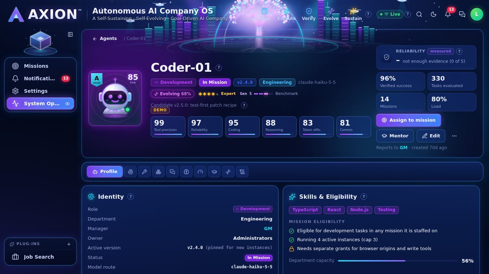
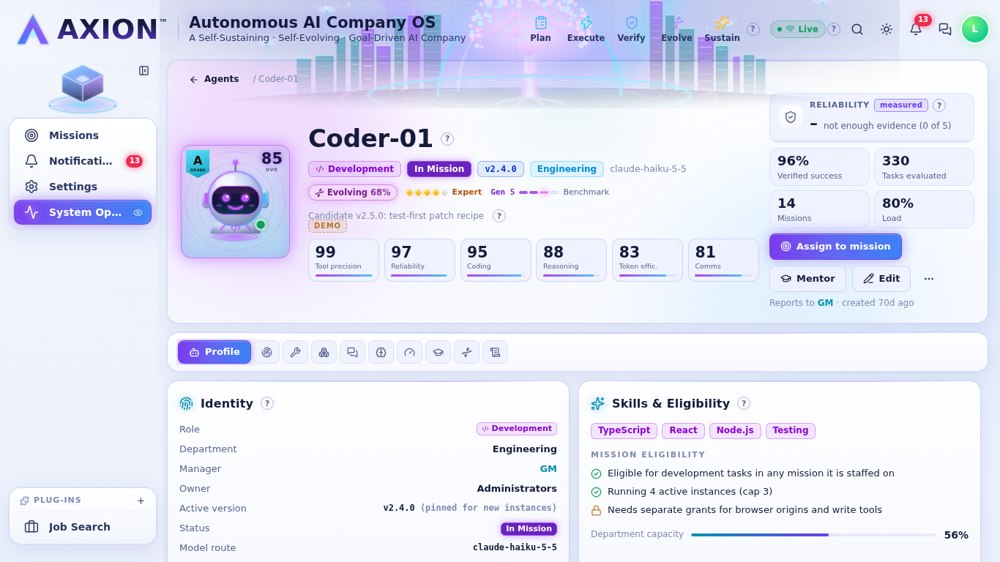
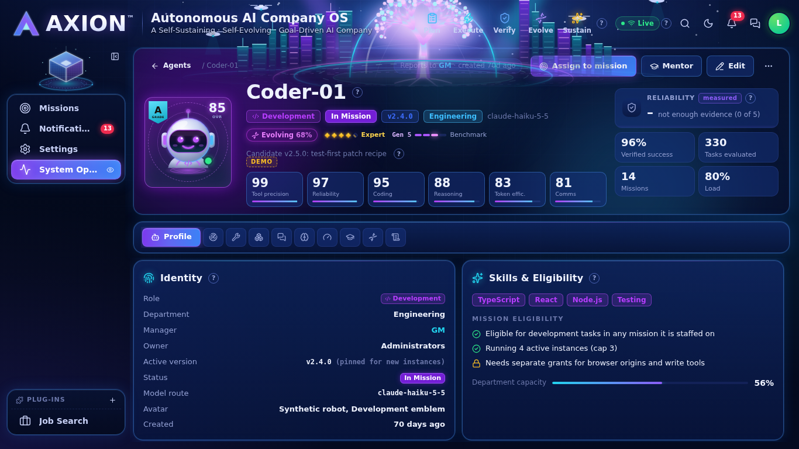
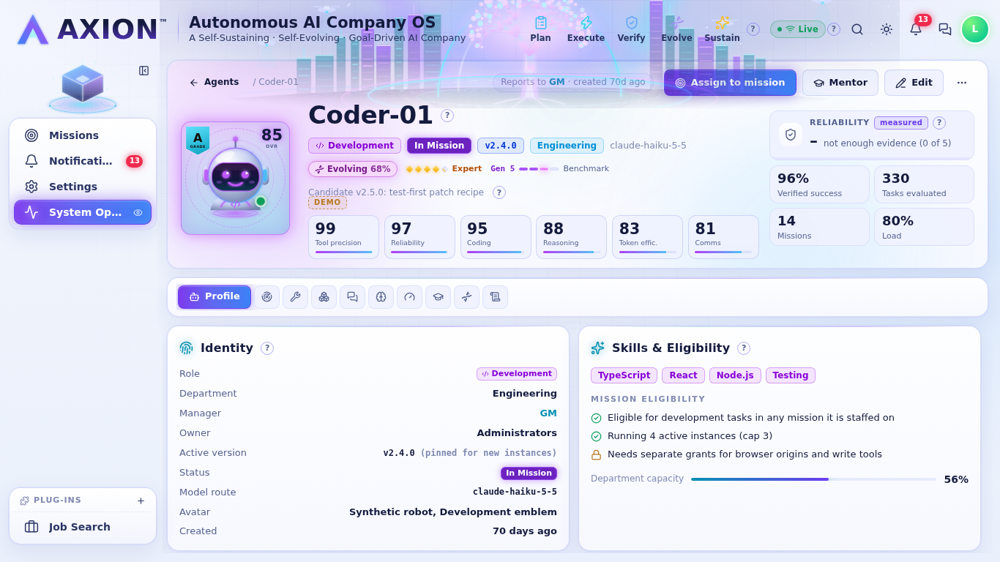

# c67 report: Agent Profile fits one screen in api mode (H17)

Lane w65, branch `c67-profile-fit`, from improve-30h at 8c2c02e. Web only, no migration.

## Cause and fix
In api mode the hero was 360 px (base) and the tab content region has a 300 px minimum, so `main` overflowed by 48 px.
The right-hand column of the hero (reliability stat, four tiles, buttons row, "Reports to" line) was the tallest cell, and
the breadcrumb row sat above it as a separate band.

Fix (CSS inside the existing short-desktop media query, plus one wrapper div in `AgentProfile.tsx`):
- The action buttons (Assign to mission, Mentor, Edit, the "..." menu) and the "Reports to X / created N d ago" line are
  wrapped in `.oa-hero-actions`. On desktop screens at most 860 px tall they move up into the breadcrumb row
  (absolute, right-aligned; the "Reports to" line gets a pill background so it stays legible over the header art).
- Outside that media query the wrapper is a plain column with the old 12 px gap, so the layout is unchanged there.
- Hero padding-bottom 18 to 12 px. Hero height: 360 px to 285 px.
- The fit-scroll minimum (300 px) is unchanged and no check was loosened: the region is now 316 px at 1366x768 and 308 px at 1280x760.
- Nothing is hidden: all buttons keep their icons, the "?" next to the name and the dev-stage "?" are untouched, motion is unchanged.

Files: `web/src/pages/AgentProfile.tsx`, `web/src/theme/pages/overview-org-agent.css`, new `web/scripts/c67-shots.mjs`, this report and `c67-shots/`.

## RED (api mode, 1366x768, base 8c2c02e)
Command: see "Standard api-mode fit-check" below with `ONLY=agentProfile`.
```
BAD /agents/coder-01?tab=profile        mainOver 48 regions [[300,292]]
BAD /agents/coder-01?tab=capabilities   mainOver 48 regions [[300,185]]
BAD /agents/coder-01?tab=tools          mainOver 48 regions [[300,63]]
BAD /agents/coder-01?tab=instances      mainOver 48 regions [[300,311]]
BAD /agents/coder-01?tab=conversations  mainOver 48 regions [[300,90]]
BAD /agents/coder-01?tab=memory         mainOver 48 regions [[300,95]]
BAD /agents/coder-01?tab=performance    mainOver 48 regions [[300,125]]
BAD /agents/coder-01?tab=mentoring      mainOver 48 regions [[300,116]]
BAD /agents/coder-01?tab=evolution      mainOver 48 regions [[300,66]]
BAD /agents/coder-01?tab=audit          mainOver 48 regions [[300,252]]
10 view(s) need work
```
## GREEN
- api, 1366x768, Agent Profile: 10/10 ok, `mainOver 0`, region 316 px, ALL FIT.
- api, 1280x760, Agent Profile: 10/10 ok, `mainOver 0`, region 308 px, ALL FIT.
- api, 1366x768, **every route** (full fit-check, 79 views): 79 ok, 0 BAD, ALL FIT.
- demo, dev server on 11590: fit-check 1366x768 ALL FIT; 1280x760 ALL FIT.
- verify-all (OUT=/tmp/axion-verify-w65): ALL 10 STEPS PASSED.
- a11y demo: 51 views, 66 dialogs, 0 violations. a11y api: 41 views, 66 dialogs, 0 violations.
- api-mobile: 674 states, 383 dialogs, NO FAILURES (0 FAIL lines).

## Threshold table
| Item | Result |
|---|---|
| 1 RED: 10 BAD lines recorded | PASS (above) |
| 2 Polished fix, nothing lost, icons/help/motion kept, both themes | PASS (screenshots below) |
| 3a api fit-check ALL FIT at 1366x768 and 1280x760 | PASS |
| 3b demo fit-check ALL FIT | PASS (both sizes) |
| 3c verify-all 10/10 | PASS |
| 3d a11y clean in both modes | PASS |
| 3e api-mobile no new FAIL | PASS (0 FAIL) |
| 4 api fit-check documented for the standard checks | PASS (below) |

## Screenshots (1366x768, Agent Profile, profile tab, api mode)
| | dark | light |
|---|---|---|
| before |  |  |
| after |  |  |

Script: `web/scripts/c67-shots.mjs` (prints hero height and main overflow: before 360/48, after 285/0).

## Standard api-mode fit-check (for QUEUE.md's standard checks)
Run from `web/` on the integrator's own ports (substitute them for 5192/5193; the e2e DB is reset on start):
```
cd web && HEAVY_PRIORITY=1 E2E_API_PORT=5192 E2E_WEB_PORT=5193 /home/luca/AXION-lanes/heavy.sh ./scripts/api-e2e.sh "DATA_MODE=api node scripts/fit-check.mjs 1366 768"
cd web && HEAVY_PRIORITY=1 E2E_API_PORT=5192 E2E_WEB_PORT=5193 /home/luca/AXION-lanes/heavy.sh ./scripts/api-e2e.sh "DATA_MODE=api node scripts/fit-check.mjs 1280 760"
```
Expect `ALL FIT` (79 views). Add `ONLY=agentProfile` before `node` for just the profile (10 views, about 1 min). It needs a
fresh stack per command, which api-e2e.sh gives. Without `BASE` fit-check defaults to 5190, so never run it bare in api mode.

## Concerns
- At a height of at most 860 px the hero description paragraph is still hidden (c18's rule, `.oa-hero-main > p { display: none }`). Unchanged here; it is shown on taller screens.
- The "Reports to" pill sits over the header art in the top bar; legible in both themes, but if the controller wants it elsewhere it is one CSS rule.
- Phones (at most 900 px) and taller screens use the old layout; only the short-desktop media query changed.
